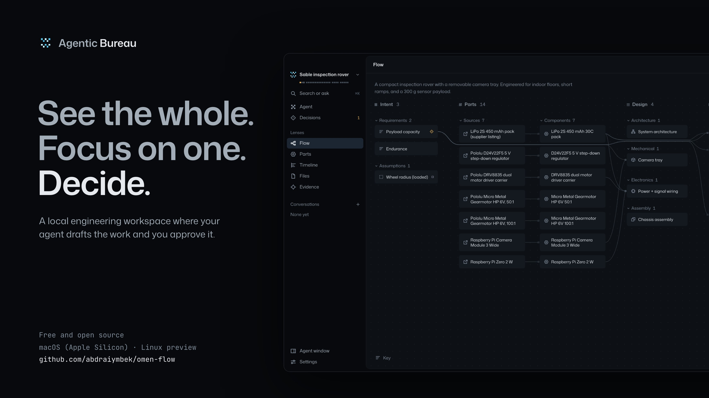
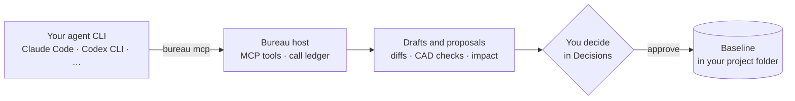

<p align="center">
  
</p>

<p align="center">
  <a href="https://github.com/abdraiymbek/agentic-bureau/releases/latest"></a>
  <a href="https://github.com/abdraiymbek/agentic-bureau/actions/workflows/ci.yml"></a>
  
  <a href="LICENSE"></a>
</p>

<p align="center">
  <a href="#install">Install</a> ·
  <a href="#quick-start">Quick start</a> ·
  <a href="#features">Features</a> ·
  <a href="#how-it-works">How it works</a> ·
  <a href="#build-from-source">Build from source</a> ·
  <a href="#documentation">Docs</a> ·
  <a href="#limits">Limits</a>
</p>

---

**Agentic Bureau** (Bureau in the app) is a desktop engineering workspace that runs on your own
machine. Bring the agent CLI you already use (Claude Code, Codex CLI or another). It runs inside
Bureau, as a conversation or in a real terminal, and drafts engineering work through Bureau's MCP
tools: requirements, parts, CAD, calculations, wiring and tests.

**Nothing the agent writes becomes the baseline until a person approves it.** Approval records a
decision; it does not establish engineering validity.

Everything lives in the project folder: a schema 1 SQLite record, an object store of immutable
files, and readable working files. The app is Rust (Tauri) with a React renderer in the operating
system's webview. It contains no Electron and no Node runtime, and it includes no model and no
account: your agent CLI brings those.

> [!NOTE]
> **[Download Bureau 0.2.5](https://github.com/abdraiymbek/agentic-bureau/releases/latest)** for
> macOS 13.3+ on Apple Silicon, or the Linux preview (x86_64, arm64). 0.2.5 is a preview: the macOS
> app is ad hoc signed but not notarized, and the Linux packages are unsigned. See
> [Limits](#limits).

## Features

- **See the whole, focus on one, decide.** Three zoom levels. First, the project through one lens:
  **Flow** (a causal map of every object, inputs on the left and consequences on the right),
  **Parts**, **Timeline**, **Files** or **Evidence** (`⌘1`–`⌘5`). Then one object on a stage,
  between the rails of what it depends on and what it affects. Then one decision. There is no
  dashboard.
- **Your agent, inside the app.** The agent surface has two panes. **Conversation** runs Codex CLI
  or Claude Code headless, once per message, and shows the cards the run presents: a part in 3D
  with its dimensions, recorded objects, quantities, choices and human review. **Terminal** is one
  real PTY running any agent CLI. The activity rail lists only calls from the host's ledger.
- **Human review, enforced.** Proposals are reviewed one at a time under **Decisions** (`⌘⇧D`)
  with field-level diffs, CAD comparison, verification status and impact. Approval is refused when
  the baseline moved after the proposal was drafted (`REVISION_CONFLICT`). Agents cannot approve,
  accept or revert anything.
- **Evidence, not inference.** The Evidence lens is the requirement → evidence matrix: each
  requirement's target and coverage (covered, partly covered, out of date, no evidence), with the
  linked calculations and tests and their recorded results. Pass or fail appears only when a test
  recorded a verdict. It is never inferred by comparing numbers.
- **An agent that can see.** `cad_view` draws a part as a drawing sheet: front, top and right
  views at one scale with hidden edges dashed, an isometric view and filled cross-sections.
  `image_view` shows a drawing in the project with a labelled grid, or enlarges a region until its
  callouts can be read. These pictures help the agent find problems, but only `cad_check` verifies
  a part.
- **Right-sized for small and large models.** Each session is fixed to a `compact`, `standard` or
  `full` capability profile. A small model (Haiku, Luna, mini, local models) gets 15 flat tools,
  playbooks on demand and a server-owned completion gate (`work_status`). A large model keeps the
  full surface of 60 tools. Verification rules are the same in every profile, and every
  agent-allowed operation stays callable through `tool_call`.
- **Local and portable.** One project folder holds the record, the objects and the working files.
  Export a project archive to keep the history elsewhere, or a build package of approved
  deliverables.

<details>
<summary><strong>More on the agent surface and the introduction</strong></summary>

<br />

- **Where it lives.** There is one agent surface per open project, shown as the Agent tab, a
  floating window or a dock (`⌘J`). One agent works in a project at a time. The Terminal pane has
  a session bar showing status, agent, model, tool profile, the tools listed, and the calls and
  failures the host recorded.
- **You stay in control of sending.** Edit a card's values and **Prepare** attaches the exact
  values to your request; only **Send** runs the agent. “Ask agent” anywhere drafts an editable
  request in the active pane. It never sends for you.
- **Unfinished work is labelled.** When a response ends with work that `work_status` still lists
  as unfinished, the turn shows Bureau's record of it, **Work not finished**, and **Continue**
  sends one fixed, labelled continuation. With Settings → Agents → **Continue once** (off by
  default), Bureau sends it itself, once per message you sent, labelled as its own.
- **Honest attribution.** Each turn names its model: what the CLI reported, or else the id Bureau
  passed. Bureau never parses or shows a CLI's cost figure in its own interface.
- **Conversations stay in the project.** They are kept in `.bureau/chat/conversations.json` in the
  project folder. Project archives do not include them.
- **The introduction.** It plays once, on first launch, over the launcher. The rover's causal map
  draws itself and lights a thread, the camera tray zooms into a live 3D stage, a proposal is
  approved and its impact travels the recorded links. Then the setup steps do the real thing:
  agent CLI detection and choice, the OpenSCAD probe, theme, shortcuts, and where everything
  lives. Nothing in it reaches a record. Replay it from Settings, the launcher, `⌘K` or the
  catalogue.

Details: [agent adapters](docs/agent-adapters.md) and [the design specification](design-system/design.md).

</details>

## How it works



1. **The agent works through Bureau.** Your agent CLI calls Bureau's tools through the bundled
   `bureau` helper (`bureau mcp`, `bureau call`). Every call is recorded in the host's ledger,
   without its arguments, and the activity rail shows only what that ledger recorded.
2. **Its work arrives as drafts.** An edit is a new revision, never the baseline itself. Proposals
   carry field-level diffs, CAD comparison, verification status and the impact on everything that
   depends on the change.
3. **You decide.** Only a person approves a proposal or changes a baseline, and approval is refused
   if the baseline moved after the change was drafted.

## Install

### Requirements

| Requirement                              | Details                                                                                                                                                                                                                |
| ---------------------------------------- | ---------------------------------------------------------------------------------------------------------------------------------------------------------------------------------------------------------------------- |
| **Operating system**                     | macOS 13.3 or later on Apple Silicon, or Linux with glibc 2.35 or later (Ubuntu 22.04+, Debian 12+, Fedora 42+; the Linux build is a preview)                                                                          |
| **An agent CLI, signed in**              | Claude Code and Codex CLI are verified with this release; OpenCode, Gemini CLI and Qwen Code follow their documentation; any other CLI can run as a Custom CLI. Bureau does not include a model or an account          |
| **OpenSCAD**                             | Renders and checks parts. Not bundled; everything else works without it. macOS: `brew install --cask openscad@snapshot`. Linux: your distribution's package (`sudo apt install openscad`, `sudo dnf install openscad`) |
| **Python 3.11–3.14 with OCP** (optional) | `cadquery-ocp-novtk==7.9.3.1.1` makes STEP exports exact; without it they are faceted. Not bundled; see [STEP export](docs/engineering-adapters.md#step-export)                                                        |

### macOS

Download `Bureau-0.2.5-macos-arm64.dmg` from the
[latest release](https://github.com/abdraiymbek/agentic-bureau/releases/latest). The app is ad hoc
signed to protect its contents, but it is not notarized by Apple, so macOS asks you to approve it
on first launch:

1. Open the DMG and drag **Bureau** onto **Applications**.
2. Eject the DMG and open Bureau from Applications. If macOS says it cannot verify the app,
   dismiss that message.
3. Open **System Settings → Privacy & Security**, find “Bureau was blocked…” and choose
   **Open Anyway**, then confirm **Open** and authenticate if asked. macOS remembers the exception
   and may ask again after an update. See [Apple's instructions](https://support.apple.com/en-us/102445).

The DMG includes these steps in `INSTALL.txt`. If macOS reports that the app is damaged, download a
fresh copy from the official release, verify it against `SHA256SUMS`, and
[report the problem](https://github.com/abdraiymbek/agentic-bureau/issues) if it persists.

### Linux (preview)

Download the file for your system and architecture from the
[latest release](https://github.com/abdraiymbek/agentic-bureau/releases/latest) (`amd64`/`x86_64`
for most PCs, `arm64`/`aarch64` for ARM machines):

| System                    | File                           | Install                                              |
| ------------------------- | ------------------------------ | ---------------------------------------------------- |
| Ubuntu 22.04+, Debian 12+ | `bureau_0.2.5_amd64.deb`       | `sudo apt install ./bureau_0.2.5_amd64.deb`          |
| Fedora 42+                | `bureau-0.2.5-1.x86_64.rpm`    | `sudo dnf install ./bureau-0.2.5-1.x86_64.rpm`       |
| Other distributions       | `Bureau-0.2.5-x86_64.AppImage` | `chmod +x Bureau-0.2.5-x86_64.AppImage`, then run it |

The `arm64` files follow the same names (`bureau_0.2.5_arm64.deb`, `bureau-0.2.5-1.aarch64.rpm`,
`Bureau-0.2.5-aarch64.AppImage`). The packages install **Bureau** in the applications menu and the
`agentic-bureau` command, and apt or dnf pulls in WebKitGTK and the other libraries. The AppImage
needs FUSE 3 (`sudo apt install fuse3`) or `APPIMAGE_EXTRACT_AND_RUN=1`.

The Linux build has been installed and run in fresh Ubuntu, Debian and Fedora containers, but not
yet on a real desktop. Please [report what you find](https://github.com/abdraiymbek/agentic-bureau/issues).

### Verify the download

Each release lists the SHA-256 of every file in `SHA256SUMS`. In the folder you downloaded to:

```sh
shasum -a 256 -c SHA256SUMS --ignore-missing   # macOS
sha256sum -c SHA256SUMS --ignore-missing       # Linux
```

### Update and uninstall

- **Update** by installing a newer release over the old one. Your projects live in the folders you
  chose and are never changed by installing or removing the app.
- **Settings** (recent projects, agent and engine settings) are kept in
  `~/Library/Application Support/app.agenticbureau.desktop` on macOS and
  `~/.local/share/app.agenticbureau.desktop` on Linux.
- **Uninstall** by moving the app to the Trash (macOS) or running `sudo apt remove bureau` /
  `sudo dnf remove bureau` (Linux). Delete the settings folder too if you want a clean slate.
- **Coming from Omen Flow?** Bureau is its new name, installed as a separate app. Bureau reads
  Omen Flow's settings on first launch and renames an older project's `.omenflow` folder when it
  opens it. Remove Omen Flow by moving it to the Trash, or with `sudo apt remove omen-flow` /
  `sudo dnf remove omen-flow`.

To build the app yourself, see [Build from source](#build-from-source) and [release](docs/release.md).

## Quick start

1. **Install OpenSCAD and an agent CLI**, and sign in to the CLI. On macOS:
   `brew install --cask openscad@snapshot` (the engine is not bundled).
2. **Open Bureau.** On first launch a short introduction plays, then setup steps detect your agent
   CLI and OpenSCAD, let you pick Dark or Light and show the shortcuts. `Esc` skips it;
   Settings → Appearance plays it again. Answer _What are you building?_ and choose an empty
   folder.
3. **Talk to the agent.** The project opens on the Agent tab's **Conversation**: write what you
   want and press Send. Codex CLI or Claude Code runs once per message. Switch to **Terminal** to
   run any agent CLI interactively. If exactly one is found (or the one you chose before is), it
   starts; with several, you choose once; with none, the tab lists each with its install guide and
   **Set path…**. Settings (`⌘,`) holds each agent's model, tool profile and executable.
4. **Review its work.** Watch its calls in the activity rail, and review its proposals under
   **Decisions** (`⌘⇧D`). Check what is still unproven in the **Evidence** lens (`⌘5`).
5. **Keep the history.** Export a project archive from the project menu in the titlebar (or the
   Files lens). The build package exports approved deliverables.

Closing a project stops its agent. A project written by a newer build opens read-only.

## Supported agent CLIs

| CLI         | Status in this build                                                                     |
| ----------- | ---------------------------------------------------------------------------------------- |
| Codex CLI   | Verified: launch line checked against the installed CLI (0.156.1); supports `>= 0.150.0` |
| Claude Code | Verified: launch line checked against the installed CLI (2.1.287); supports `>= 2.1.0`   |
| OpenCode    | Documented, not verified here                                                            |
| Gemini CLI  | Documented, not verified here                                                            |
| Qwen Code   | Documented, not verified here                                                            |
| Custom CLI  | Any executable; gets the `bureau` helper on PATH and a bounded `AGENTS.md` block         |

“Verified” means the arguments Bureau passes were checked against that CLI's `--help` and binary
on the build machine, and the automated tests assert them with stand-in executables. The tests do
not run a live model; live model runs are recorded separately in the
[V1 readiness record](audit/v1/README.md). See [agent adapters](docs/agent-adapters.md).

## Build from source

You need Node 24 (`.nvmrc`), pnpm 9.15.9, the stable Rust toolchain (`rust-toolchain.toml`), and
OpenSCAD for the CAD engine tests. [Development](docs/development.md) has every command and what
it needs.

```sh
pnpm install --frozen-lockfile
pnpm rebuild:node            # node-pty from source, for the legacy PTY tests (macOS)
pnpm contracts:check         # registry.json matches the TypeScript contracts
cargo test --workspace       # Rust core, storage, host, headless, desktop shell
pnpm test                    # legacy TypeScript oracle and renderer tests
pnpm test:conformance        # the corpus against the Rust headless host
pnpm typecheck
pnpm lint
pnpm design:preview          # the real renderer on the Rust headless host, disposable data
```

| Command                                  | What it does                                                                                                                                                                                        |
| ---------------------------------------- | --------------------------------------------------------------------------------------------------------------------------------------------------------------------------------------------------- |
| `pnpm design:preview`                    | Builds `bureau-host` and the `bureau` helper, builds the rover and drone fixtures in a temporary folder, and serves the real renderer on `http://127.0.0.1:5173` (`BUREAU_PREVIEW_PORT` changes it) |
| `pnpm dev`                               | Builds the helper, starts the renderer's Vite server on port 5174 and runs `tauri dev`                                                                                                              |
| `pnpm make` (alias `pnpm package`)       | Builds the helper, the static renderer and the release Tauri app: `target/release/bundle/macos/Bureau.app` and a DMG on macOS, ad hoc signed                                                        |
| `pnpm smoke:packaged` / `smoke:headless` | Launches the bundle (or `bureau-host`, with no window) with disposable state and drives the helper through a real agent grant                                                                       |
| `pnpm release:macos`                     | Signs and notarizes; refuses to run without Apple credentials. See [release](docs/release.md)                                                                                                       |
| `pnpm eval:agent`                        | The live-model evaluation of the agent layer (`-- --out <dir>`; [`evals/agent/`](evals/agent/README.md)). **It spends your model account's credits**                                                |

<details>
<summary><strong>Notes on the preview, packaging and evaluations</strong></summary>

<br />

- **Design preview.** Open the address `pnpm design:preview` prints: it carries a one-time key
  that the page trades for a cookie, so only that browser can use the preview. Terminals and agent
  settings are off unless it was started with `BUREAU_PREVIEW_AGENTS=1`, because a Custom CLI runs
  any executable, and Codex CLI and Claude Code run models and may update themselves. The
  temporary folder is removed when the preview stops. Research browsing is not available in the
  headless host.
- **Packaging.** `CI=true pnpm make` skips the DMG's Finder layout where a session cannot script
  Finder. Linux packages are built by `node scripts/linux-package.mjs`; see
  [release](docs/release.md#linux-packages).
- **Evaluation spend.** Nothing caps the spend of `pnpm eval:agent`: a Claude Code cell is bounded
  by 40 turns (`--max-turns`) and every cell by 10 minutes (`--timeout-min`). A Claude Code cell's
  list-price cost is estimated afterwards from a dated price table
  ([`pricing.ts`](evals/agent/pricing.ts)); Codex cells get no cost estimate. `--reference good`
  and `--reference bad` check the judges with scripted sessions and no model.

</details>

### Repository layout

| Path                                                        | Role                                                                                                                                                                           |
| ----------------------------------------------------------- | ------------------------------------------------------------------------------------------------------------------------------------------------------------------------------ |
| `packages/contracts/`                                       | Source of truth for operations, entities, units and errors (TypeScript, zod). `pnpm contracts:export` writes `crates/contracts/registry.json`                                  |
| `crates/contracts/`                                         | The exported registry (113 operations), input validation, lossless agent-input repair, typed errors                                                                            |
| `crates/storage/`                                           | SQLite schema 1, FTS5 search tables, content-addressed object store, project path guards                                                                                       |
| `crates/core/`                                              | The domain: revisions, proposals and decisions, freshness graph, CAD (OpenSCAD + mesh checks), calculations, parts and BOM, wiring, tests, completion gate, coverage, archives |
| `crates/agent-host/`                                        | The shared `Host`: command routing, PTY sessions, adapters, capability profiles, bridge socket, MCP server, call ledger, playbooks                                             |
| `apps/rust-desktop/`                                        | Thin Tauri shell over `Host`: window, events, isolated research webview, menu, single-instance lock                                                                            |
| `apps/headless/`                                            | `bureau-host`: the same `Host` over loopback HTTP and server-sent events, for the design preview, conformance tests, fixtures and evaluations                                  |
| `apps/desktop/src/renderer/`                                | The Lens renderer (React, Vite, zustand, three.js, xterm)                                                                                                                      |
| `native/bureau-bridge/`                                     | The bundled `bureau` helper an agent CLI calls: `mcp`, `call`, `guide`, `status`                                                                                               |
| `packages/{core,storage,agent-host,mcp-server,engineering}` | The earlier TypeScript implementation, kept as a behaviour oracle for `pnpm test`; not shipped                                                                                 |
| `tests/conformance/`                                        | Dispatch-level corpus run against the Rust host                                                                                                                                |
| `design-system/`                                            | Lens tokens, fonts, brand, specification and verification record                                                                                                               |

The legacy TypeScript packages answer the same operation names, and the domain tests in
`pnpm test` run against them. Operations and inputs that only the Rust host implements are refused
there with a typed error instead of being silently ignored. New behaviour belongs in Rust and the
contracts. See [architecture](docs/architecture.md).

## Limits

Bureau 0.2.5 is a preview. What it does not do yet, and what has not been checked:

- **Platforms.** The macOS app (version 0.2.5, identifier `app.agenticbureau.desktop`, macOS 13.3
  or later, Apple Silicon only) is ad hoc signed, not notarized, so macOS asks you to allow it once
  (see [Install](#macos)). Intel Macs and Windows are not supported by this release.
- **Linux is a preview.** The `.deb`, `.rpm` and AppImage are unsigned, built in an Ubuntu 22.04
  container and need glibc 2.35 or later; both packages declare it. On arm64 each was installed or
  run in a fresh container (the `.deb` on Ubuntu 22.04, Ubuntu 24.04 and Debian 12, the AppImage
  on Ubuntu 22.04, the `.rpm` on Fedora 42) and passed the packaged smoke under a virtual X
  display, including a stand-in agent session that a SIGTERM to the app ended cleanly. x86_64
  packages use the same recipe in the release workflow. Nobody has used them on a real Linux
  desktop: Wayland, GPU drivers, HiDPI and the on-screen look of native dialogs are unverified.
  See [release](docs/release.md#linux-packages) and the
  [0.2.5 verification record](audit/v0.2.5/README.md).
- **Native walkthroughs.** The Rust app was verified with automated suites, browser walkthroughs
  and a QA pass on the Rust headless host, and an adversarial review whose fixes each carry a
  regression test. The release bundle was launched only by the packaged smoke and a window check;
  the last native walkthrough by hand is the [26 September audit](audit/v1-readiness/README.md),
  which predates the 0.2 releases.
- **Live-model evaluation.** One run per cell (Claude Code and Codex CLI on four tasks), so its
  outcomes are observations, not rates. See the [V1 readiness record](audit/v1/README.md).
- **Not a sandbox.** The agent runs with your operating-system permissions. Bureau's review gate
  controls what enters the engineering baseline; it does not contain the agent. See
  [security](SECURITY.md).
- **Research browsing** (an isolated webview reading public pages) exists only in the desktop app.
- **STEP export** (**Export STEP** in a part's view, `cad_export` for agents) has exact surfaces
  only with the optional converter, and only for what it rebuilds. `minkowski()`, `resize()`, a
  chamfered `offset()`, a twisted or scaled `linear_extrude`, `roof()` and `projection()` make a
  faceted file; a `hull()` of anything but upright cylinders or circles is planar facets; so is a
  part with a surface too thin for the comparison's probes. The rebuild is compared with the render
  at probe points, so a lost feature that blends into a face at under 30° (a shallow dimple, groove
  or blend), or a little added material, can go unseen, and the file is then called exact all the
  same (on a 100 mm plate, lost dimples up to 2.5 mm across went unseen). A faceted file is the
  render's triangles merged into planar faces (median 1.3 MB, at most 7.5 MB on the 49-part
  CADGenBench corpus); large ones are slow to open in some CAD tools. The exact rules are in
  [STEP export](docs/engineering-adapters.md#step-export).
- **Pictures.** `image_view` reads PNG and JPEG files only: export a PDF or SVG drawing page as PNG
  first. `cad_view` draws parts that have OpenSCAD source, as `cad_inspect` measures them.
- **Archives** carry the record, objects and working files, not readable per-artifact views. Agent
  call history and conversations stay out of archives.
- **Going back to 0.2.3.** A 0.2.3 build ignores the CAD checks 0.2.5 records: it shows each part
  by its newest check from 0.2.3 or earlier, so a part whose newest 0.2.5 check failed can read
  there as verified. If you go back, check parts again before relying on them, and again when you
  return. See [going back to 0.2.3](docs/project-format.md#going-back-to-023).

## Documentation

| Topic                                               | What you'll find                                                                |
| --------------------------------------------------- | ------------------------------------------------------------------------------- |
| [Architecture](docs/architecture.md)                | Processes, the two entries into the core, crates and apps, invariants           |
| [Agent adapters](docs/agent-adapters.md)            | Adapters, sessions, capability profiles, the MCP server, the ledger, the helper |
| [Engineering engines](docs/engineering-adapters.md) | CAD with OpenSCAD, STEP export, calculations, parts and BOM, wiring, tests      |
| [Project format](docs/project-format.md)            | Canonical state, compatibility rules, objects, archives, what is stored where   |
| [Development](docs/development.md)                  | Requirements, commands, the headless host, the design preview, evaluations      |
| [Release](docs/release.md)                          | Qualifying and publishing a release, signing, Linux packages                    |
| [Design specification](design-system/design.md)     | The Lens interaction model, visual language, tokens and extension checklist     |
| [Security](SECURITY.md)                             | The threat model, what the review gate protects and what it does not            |
| [Contributing](CONTRIBUTING.md)                     | How a change flows: contracts first, then Rust, storage rules, tests            |

### Status and records

Current status and verification numbers are in the
[0.2.5 verification record](audit/v0.2.5/README.md); [build status](BUILD_STATUS.md) lists the
open gates. Releases 0.2.0–0.2.3 were first published as 1.0.0–1.0.3 and renumbered on
21 October 2026, because Bureau is a preview, not a 1.0; the earlier records keep the original
numbers. Earlier records: [V1 readiness record](audit/v1/README.md) and [`audit/`](audit/).

## Contributing and support

Bug reports and ideas are welcome in [issues](https://github.com/abdraiymbek/agentic-bureau/issues).
Before opening a pull request, read [CONTRIBUTING.md](CONTRIBUTING.md) and, for interface work,
[AGENTS.md](AGENTS.md) and [the design specification](design-system/design.md). A private
channel for security reports is coming soon; until then, please keep vulnerability details out of
public issues and follow [SECURITY.md](SECURITY.md).

## License

Bureau is licensed under the Apache License 2.0: see [LICENSE](LICENSE) and [NOTICE](NOTICE). The
app includes third-party crates, packages and fonts under their own permissive licences, listed
with their copyright notices in [THIRD_PARTY_NOTICES.md](THIRD_PARTY_NOTICES.md) and shipped
inside every release package. OpenSCAD, Python with OCP (OpenCASCADE, LGPL) for exact STEP export,
and agent CLIs are installed separately and keep their own licences.
