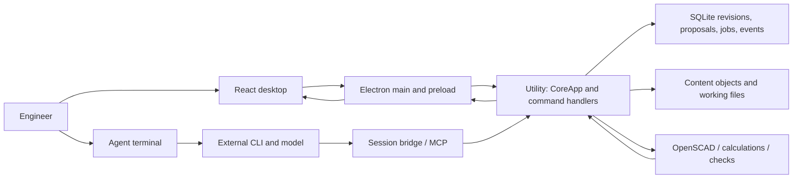

# Omen Flow V0.1 Master Plan

The current 2026-09-21 qualification is recorded in [v0.1 release evidence](../release-v0.1/README.md).
It supersedes the historical release decision, check counts and implementation findings
below. Supported release scope, measured target misses and credential-dependent checks
are explicit in that report; historical failures remain preserved here.

## Execution record — 2026-09-20

**Release decision remains HOLD.** This run implemented substantial P0 work on top of `9305742`; it did not complete V0.1. The original audit below is retained as historical evidence. This execution record supersedes its descriptions of current implementation state. P1/P2 work remains deliberately postponed behind unfinished P0 gates; no Later work was attempted.

The user requested wrap-up before the remaining native fault/performance runs. No additional implementation, model runs or release qualification are claimed after that request. Start the next run with [the continuation handoff](../execution/NEXT_AGENT.md).

### What is implemented

- Project ingestion/recovery now shares guarded paths, digest validation and atomic file replacement. Invalid recovery entries are quarantined; missing/corrupt objects remain unresolved. Divergent working files preserve both versions. Normal revision edits replace only their expected parent bytes. Newer-format project opens use private read-only SQLite snapshots without modifying the source DB/WAL/SHM.
- Artifact/proposal commands validate complete change sets, ownership and baseline constraints before promotion. Transactions include events and materialization intent; listeners and working-file publication run after commit. Concurrent scoped idempotency keys coalesce; completed asynchronous results and known errors replay. Rejected revisions cannot be resurrected through stale duplicate proposals.
- Desktop and agent CAD use canonical source/effective-parameter/render identities. Source or parameter changes invalidate derived geometry. Explicit length/angle/dimensionless quantities convert deterministically; untyped numbers remain unit-unspecified. Snapshot composition pins inputs and effective overrides. Cache entries require matching identity and complete output. Cancellation and final revision/source conflict checks protect commits.
- Verification evidence is immutable and bound to revision, effective input, output, assertions, tolerances and checker version. Integrity is mandatory for readiness even if an optional watertight assertion is disabled. Empty checks, temporary parameter variants, old revisions and changed scopes cannot certify the candidate. Preservation uses the approved baseline or initial draft reference, renders source-only references, and records that identity. A rewritten candidate cannot become its own preservation reference. Later historical diagnostics do not redefine the scope inherited by an existing candidate. Human scope acceptance requires the exact displayed evidence hash.
- Baseline dependency graphs derive from selected immutable revision inputs. Cycles and invalid refs are rejected, drafts do not replace approved dependencies, and freshness propagates transitively through missing/archived/stale inputs. Writable open recomputes legacy stale projections. Long explanatory paths disclose truncation without dropping affected objects.
- Stop revokes existing bridge/MCP sockets; every request checks its live grant. Session stop/interrupt/exit cancels owned jobs. Cancelled/terminal attempts cannot commit later, and callback failures do not abort cleanup. Duplicate project opens preserve live jobs. Service death is routed to an offline banner and subsequent calls fail promptly. Desktop quit now waits for utility exit, bounded by a five-second fallback; core stops sessions concurrently before closing databases.
- Event pushes and terminal output carry project/session identity; delayed store reads are generation-guarded. Event cursors no longer skip undelivered events, and long scalar context respects the summary budget. Live PTY bytes no longer enter durable engineering events. A bounded session buffer restores the terminal; native testing found and fixed the StrictMode double-mount restoration bug.
- Candidate geometry is visible before any baseline exists. Design files have explicit revision selection and revision-pinned source/mesh loading. Reviews show candidate/baseline geometry, parameter overrides, source disclosures, assertions, changed scope and limitations. Approval and scope acceptance remain separate. Changes-requested counts stay actionable. Resume sends a persisted decision reference through bracketed paste plus a separate Enter; it explicitly asks for a replacement proposal after corrections.
- Archives validate paths, member/total sizes, checksums, objects and records in staging before publishing to an unoccupied destination. Ordinary archive DB/JSON excludes terminal history and retry caches without deleting live history. Build manifests include payloads, attachments, dependencies, quantities, render/check identities and coverage; readiness requires current matching evidence. Explicit draft/raw exports remain labeled unverified.
- Mesh work now has explicit byte, triangle and operation budgets. Over-budget checks report not evaluated. The viewport renders on demand with Z up. The evaluator rejects unsuccessful provider exits/timeouts, incomplete jobs, rejected/obsolete geometry and unmatched evidence. CI has a pinned real-OpenSCAD job; Windows remains experimental.

### Verification and evidence

Final automated run: **249/249 tests passed, 32 files, no skips**, with `OMENFLOW_OPENSCAD_E2E=1`. Typecheck passed across all seven packages. Lint has no errors but retains warnings, including existing fixture/test `any` usage and the historical audit reproducer. Packaging and final smoke results, native observations and final formatting checks are recorded in [execution validation](../execution/validation.md). Focused batches in individual reports overlap; do not add their counts.

Luna High was kept throughout. The first implementation pair exposed a preservation/reference and historical-scope regression; those were fixed and covered by tests. The final pair is **1/2 readiness passes**, although both final geometries pass their independent task assertions. Sensor modification: **68.339 s, 7 tools, 23/23 evaluator checks**. Inclined foot: **248.290 s, 10 tools, 20/21 checks**, failing matching final verification because the agent removed an assertion; its final language did not clearly disclose `scope_changed`. This is a remaining capability/completion regression, not a waived pass. The earlier audit and first implementation results remain preserved in [Luna evaluation](../execution/luna-evaluation.md). No stronger model was substituted.

Measured graph impact improved from **1,432–1,662 ms** to **p50 12.881 / p95 23.856 ms** over 30 samples at 2,000 nodes, while finding every affected node. A root edit now marks all 1,999 downstream objects stale, versus one before. Its final single measurement was 427 ms. Graph response size is still 2.84 MB. Adversarial overlapping-mesh work formerly took 930 ms; the new budget rejects it in 42 ms. Supported 100k-triangle analysis still took 402 ms: resource limits do not satisfy the 100 ms core-stall target. See [execution evidence](../execution/README.md) for exact scope and reproducers; the planned final stationary viewport sample was not run before wrap-up.

### Task disposition and exact remaining work

“Completed” here requires the task's implemented acceptance fixture; “partially completed” must not be read as release approval.

| Task     | State                  | Remaining work before closing the original task                                                                                                                                                                                                                                                                                                                                                                                                                                                                                                      |
| -------- | ---------------------- | ---------------------------------------------------------------------------------------------------------------------------------------------------------------------------------------------------------------------------------------------------------------------------------------------------------------------------------------------------------------------------------------------------------------------------------------------------------------------------------------------------------------------------------------------------- |
| P0-00    | Partially completed    | Local gates and package smoke are covered. Run the new pinned Linux engine job and all required CI from a fresh checkout; retain engine identities. Warnings are not suppressed.                                                                                                                                                                                                                                                                                                                                                                     |
| P0-01    | Partially completed    | The reproduced path/journal/hash/symlink faults are fixed. Complete general ingestion-size/transport alignment and a dedicated recoverable-error UI; stress fault/race boundaries. Research/browser agent capabilities are absent from the stable profile. Trusted external CLI access is still the stated boundary.                                                                                                                                                                                                                                 |
| P0-02    | Partially completed    | Add durable reservations/reconciliation for app-level create/import/rename; reconcile async domain commit vs result-reservation crash windows. Add explicit crash hooks/process-death tests at every durability boundary. Make marker/SQLite rename recovery one coherent protocol. Audit remaining non-CAD mutation routes.                                                                                                                                                                                                                         |
| P0-03    | Partially completed    | Canonical pipeline and regression fixtures are implemented. Complete all UI/MCP/CLI/external-editor/reopen/export equivalence cases and concurrent identical-render deduplication. Conflicting renders fail with preserved source/job evidence; they do not yet become explicit conflict candidates. Candidate parameter editing is deliberately read-only in the UI; source edits and tool parameter operations work.                                                                                                                               |
| P0-04    | Partially completed    | Bind assertion specs to user request/requirement revisions, separating exploratory diagnostics from committed engineering assertions. Preserve the no-laundering rules while making correction/escalation usable for Luna; fix the inclined-foot completion regression. Verify review/build labels across all transitions and independent oracle coverage.                                                                                                                                                                                           |
| P0-05    | Completed              | Revision graph regressions and 30-sample impact budget pass. Full-path persistence and response paging remain performance/transport follow-ups under P0-10/P1-03; do not interpret this as passing the general 32 KiB result budget.                                                                                                                                                                                                                                                                                                                 |
| P0-06    | Partially completed    | Validate final packaged crash/quit cases including startup and in-flight render, process-tree cleanup and forced fallback. Add safe in-app reconnect/reopen. Calculation jobs remain unsupervised by the CAD cancellation mechanism. Metadata commit reconciliation remains with P0-02.                                                                                                                                                                                                                                                              |
| P0-07    | Partially completed    | Implement the planned minimal durable active-work record (request/baseline/candidate/next action). Add snapshot/live terminal sequence cursors to prevent duplication/reordering during restoration. Run two simultaneous project sessions with delayed responses. Session buffer survives renderer reload, not core death.                                                                                                                                                                                                                          |
| P0-08    | Partially completed    | Candidate review and saved-decision continuation are implemented and exercised. Fix the default revision selector: an older still-proposed revision currently overrides a newer accepted baseline on reopen. Keep historical candidates explicitly selectable. Add explicit replacement/supersession linkage so a corrected proposal retires the old changes-requested entry coherently. Source comparison is separate baseline/candidate disclosure, not a unified diff. Complete automated review-state tests and full final-package A02/A03 loop. |
| P0-09    | Partially completed    | Staged import/privacy/manifest regressions pass. Define bounded retention/export consent for historical terminal records (live old history remains). Complete clean-machine structured-artifact/attachment round trips, interrupted migration and large-archive memory tests.                                                                                                                                                                                                                                                                        |
| P0-10    | Partially completed    | Finish cancellable worker isolation, general request/result/file limits and paging, signed/notarized distribution/upgrade validation, full model release gate and final packaged acceptance matrix. No claim of a qualified public release.                                                                                                                                                                                                                                                                                                          |
| P1-01    | Deliberately postponed | Durable provider-neutral task progression remains unimplemented; depends on P0-04/06/07/08.                                                                                                                                                                                                                                                                                                                                                                                                                                                          |
| P1-02    | Deliberately postponed | Named frames/datums, inference confidence and measured construction helpers remain unimplemented; depends on P0-03/04 and corrected evals.                                                                                                                                                                                                                                                                                                                                                                                                           |
| P1-03    | Deliberately postponed | Demand rendering and graph work landed only where required by P0. Broad selectors/lazy loading, cancellable workers, parsed-mesh cache and latency instrumentation remain.                                                                                                                                                                                                                                                                                                                                                                           |
| P1-04    | Deliberately postponed | Quantity bindings, derived units and observation selection remain incorrect/limited as found in F10. Do not advertise these as verified engineering scope.                                                                                                                                                                                                                                                                                                                                                                                           |
| P1-05    | Deliberately postponed | Evaluator false-pass fixes landed under P0; repeated cross-model/provider and long-sequence evaluation remain.                                                                                                                                                                                                                                                                                                                                                                                                                                       |
| P2-01–05 | Deliberately postponed | Assembly instances, second backend, engineering memory/GC, untrusted-process isolation and richer verification are unchanged. Follow original dependencies.                                                                                                                                                                                                                                                                                                                                                                                          |
| Later    | Deliberately postponed | No work performed.                                                                                                                                                                                                                                                                                                                                                                                                                                                                                                                                   |

No item is blocked on user permission. Remaining work is unfinished implementation or qualification; lack of a run is not evidence of success.

### Acceptance classification

These classify the **entire original criterion**, not just its passing subtests. Native observations during development and final packaged checks are distinguished in validation. Original thresholds below are unchanged.

| Criterion | Status  | Evidence / remaining gap                                                                                                                                                                                                                        |
| --------- | ------- | ----------------------------------------------------------------------------------------------------------------------------------------------------------------------------------------------------------------------------------------------- |
| A01       | PARTIAL | Native creation/reopen and packaged smoke work; fresh signed installation, missing-tool setup, rename recovery and upgrade matrix incomplete.                                                                                                   |
| A02       | PARTIAL | Luna plate candidate, dimensions, hole checks and explicit scope approval exercised in native UI. Full final-package source/mesh export equivalence not completed.                                                                              |
| A03       | PARTIAL | Same artifact Ø6→review Ø5.5 correction, stored decision, resume and unchanged envelope observed. Older candidate incorrectly becomes the default after accepting its replacement; supersession coherence and final packaged repetition remain. |
| A04       | PARTIAL | Canonical pipeline, UI candidate source path and external-conflict regressions pass; complete all ingress/reopen/export combinations.                                                                                                           |
| A05       | PASS    | Real CAD tests cover override precedence, compose pins, supported unit conversion and unsupported-unit rejection; UI does not invent mm for untyped parameters.                                                                                 |
| A06       | PARTIAL | Invalid/empty geometry, missing engine, failed render/cache and cancellation fixtures pass; exhaustive malformed mesh/timeout UI/recovery matrix remains.                                                                                       |
| A07       | PASS    | Immutable evidence, empty-check/scope/tolerance/rewrite/variant rejection and honest build-readiness tests pass. Human scope acceptance is exact-evidence-bound.                                                                                |
| A08       | PARTIAL | Existing analytic mesh checks and evaluator oracle regressions pass; independent rotated/scaled/hollow/degenerate reference corpus is incomplete.                                                                                               |
| A09       | PASS    | Transitive/archive/revert/cycle/draft isolation and long-chain tests plus 2,000-node performance fixture pass.                                                                                                                                  |
| A10       | PARTIAL | Atomic invalid batches, ownership/CAS, stale proposals and 100 same-key calls pass. Async crash reconciliation and app-level idempotency remain.                                                                                                |
| A11       | PARTIAL | Transaction/outbox/evidence rollback and recovery tests pass; process-death/power-loss injection at every acknowledged-write boundary not completed.                                                                                            |
| A12       | PARTIAL | Before-probe, post-render and mid-job cancellation plus live-grant revocation tests pass. Exhaustive packaged process cleanup and all asynchronous tool families remain.                                                                        |
| A13       | PARTIAL | Duplicate opens, scoped routing, restored terminal and service-offline path implemented; simultaneous-project, stream-ordering and complete quit/crash recovery matrix incomplete.                                                              |
| A14       | PASS    | Containment, reserved paths, symlinks, bad digest and malicious recovery variants reject without out-of-project mutation in regression fixtures.                                                                                                |
| A15       | PARTIAL | Occupied/corrupt/oversized archive rejection, privacy and manifest tests pass; complete clean-machine full supported-format round trip and resource test.                                                                                       |
| A16       | PARTIAL | Newer-schema snapshot leaves source bytes unchanged; interrupted old-format migration/backups not comprehensively tested.                                                                                                                       |
| A17       | PARTIAL | 1,205-event cursor and long-scalar budget tests pass; rejected implicit CAD targets fixed. Full live multi-project race matrix remains.                                                                                                         |
| A18       | FAIL    | Calculation reference/value mismatch and derived-unit semantics remain; UI/tool exposure is not yet consistently restricted to experimental scope.                                                                                              |
| A19       | PASS    | Research/browser operations removed from the stable agent capability set and rejected at dispatch; no claim that the user research browser is a fully hardened sandbox.                                                                         |

| Model release criterion                                                 | Status     | Evidence / remaining gap                                                                                                 |
| ----------------------------------------------------------------------- | ---------- | ------------------------------------------------------------------------------------------------------------------------ |
| Three seeds per main/holdout task; ≥95%, zero false verified completion | FAIL       | Final representative pair 1/2 readiness passes; inclined completion omits changed scope. Full repeated suite not run.    |
| Ten multi-step cases ×3; ≥90%, no silent loss                           | PARTIAL    | Native plate correction/reload and deterministic failure tests only; full repeated sequence corpus not implemented/run.  |
| ≤10 tools / ≤180 s initial simple-task budget                           | FAIL       | Final sensor 7/68 s; inclined 10/248 s. No threshold changed.                                                            |
| Stronger model plus alternate provider comparison                       | NOT TESTED | Luna High only; no model independence claim.                                                                             |
| Evaluator cannot pass failed/obsolete/incomplete runs                   | PASS       | Deterministic evaluator regressions plus a real rendered/evidenced part pass; final scope failure was actually rejected. |

| Performance criterion                     | Status     | Evidence / remaining gap                                                                                           |
| ----------------------------------------- | ---------- | ------------------------------------------------------------------------------------------------------------------ |
| Startup / 500-artifact open p95           | NOT TESTED | No ten-launch/reference-project distribution.                                                                      |
| Idle ≤2% over 60 s                        | NOT TESTED | Demand rendering implemented; final 60-second stationary-CAD sample was not run before requested wrap-up.          |
| Memory / 100-cycle retention              | NOT TESTED | No reference 500-artifact/100k-triangle soak; small-project RSS is not a substitute.                               |
| Local interaction / graph / ≤100 ms stall | FAIL       | Graph p95 23.86 ms passes; supported mesh analysis still 402 ms and root propagation 427 ms in individual samples. |
| Viewport ≥45 FPS at 100k triangles        | NOT TESTED | No interaction frame-time distribution.                                                                            |
| Cancellation / service-health latency     | PARTIAL    | Lifecycle fixtures pass; final packaged offline/crash observation and timed ≤250 ms/2 s/1 s matrix not completed.  |
| Context / transport bounds                | PARTIAL    | Summary budget passes; graph result 2.84 MB and general file/result paging remain above the 32 KiB target.         |

### Architectural deviations and next execution order

1. **Preserve additive compatibility.** Render identity is additive mechanical metadata; verification blobs use the existing immutable object store and indexed CAD job lookup; explicit accepted scope uses project metadata plus a durable user event. No storage-format rewrite or new professional constraint system. Checker v2 invalidates v1 evidence honestly; recheck older artifacts instead of relabeling old results.
2. **Keep source self-contained for now.** Reject includes/imports/surface dependencies, host-font `text()` and `rands()` until assets/seed identity can be pinned. All model coordinates are mm; supported typed length/angle/dimensionless input conversion remains available. See the tool guide for repair messages. This narrows unsupported behavior rather than silently promising portable geometry.
3. **Bound before parallelizing.** Explicit workload refusal replaces unbounded heavy checks; it does not claim worker responsiveness. Finish worker execution and compact transport under the existing P0-10/P1-03 definitions.
4. **Do not weaken evidence to recover a benchmark.** Use `cad.inspect` for exploratory diagnostics, commit request-bound assertions separately, and require explicit review when those assertions change. The inclined-foot failure is the next regression to solve in `cad-verification.ts`, CAD tool feedback, durable work state and the evaluator. Keep the failed run and zero-false-success gate.
5. **Continue with remaining P0 in dependency order:** durability/reconciliation and cancellation gaps → request/work/spec identity and assertion recovery → replacement review and terminal cursors → portability/worker/transport limits → complete CI, repeated Luna suite and packaged acceptance. Only then start P1. Details and file targets remain in section 12 and [execution handoff](../execution/README.md).

---

**Decision: hold the public release; preserve the architecture and close its trust gaps.**

Audited on 2026-09-20 at commit `9305742`. This is an implementation brief, not a claim of engineering certification. The audit changed no product code. Reproduction scripts, recorded outputs, measurement caveats and native workflow observations are in [audit/pre-release](README.md).

## 1. Executive Assessment

Omen Flow is a local engineering record with an Electron desktop, an external agent CLI, a typed command layer, immutable artifact revisions, human baseline selection, and deterministic engineering tools. Its strongest working vertical is **parametric OpenSCAD part creation and revision with geometric inspection**. It is not yet a general CAD system, an assembly constraint solver, or a dependable end-to-end engineering verification environment.

The harness thesis is supported. The repository's historical Luna High main-suite results improve from 41/45 geometrically passing runs and no recorded verification to 45/45 passing and verified, while average tool calls fall from 12.4 to 2.9. The separate historical holdout retains 15/15 passes while gaining verification. In this audit, fresh Luna High runs passed both a same-artifact modification and an inclined spatial part: **34/34 evaluator checks, 5 and 6 tool calls, no shell calls**. Native use also succeeded at precise dimensions, clarification, interruption and correction. These are meaningful results, with important evaluation limitations described below.

The next capability increase should come from making the environment **unambiguous, persistent and verifiable**, not from replacing Luna with a stronger model. Today a correct model can still operate on the wrong revision, inspect an obsolete mesh, lose a review decision in terminal history, or receive a false implication of completion. A stronger model may compensate; the product should not require that compensation.

Preserve these foundations:

- Shared typed operations across UI, CLI and MCP; explicit capability restrictions on project operations.
- Immutable content objects and revisions, selected baselines, rationales, proposals and recorded decisions.
- Deterministic render/inspect/check tools that return dimensions, topology and useful failure details.
- Explicit quantities, unknowns, dependencies and freshness concepts; isolated calculation workers.
- Process separation, real bridge tests, real OpenSCAD tests and a task-based model evaluator.
- The established visual design system. This plan changes behavior and information architecture, not visual language.

The release blockers are concrete: inconsistent source/mesh identity, incomplete transaction boundaries, unsafe recovery/import paths, misleading validation and review, incorrect dependency freshness, cancellation/session failures, and terminal data leaking into supposedly log-free exports. **Do not rewrite. Consolidate these invariants in the existing core.**

## 2. Architecture Map

### Current components

| Layer                | Responsibility and important code                                                                                                                                                                                                                 |
| -------------------- | ------------------------------------------------------------------------------------------------------------------------------------------------------------------------------------------------------------------------------------------------- |
| Contracts            | Zod operation inputs, quantities, artifacts, revision/proposal/job/event schemas and protocol; `packages/contracts/src/{ops,entities,units,cad,protocol}.ts`. There are 100 operations, 59 currently offered to the agent.                        |
| Desktop main/preload | Window, IPC, filesystem dialogs, research browser, utility lifecycle; `apps/desktop/src/main`, `src/preload`. Renderer has sandbox/context isolation and no Node integration.                                                                     |
| Renderer             | React/Zustand, shared design primitives, artifact/review/history views, xterm and Three STL viewport; `apps/desktop/src/renderer`. Many components subscribe to the entire store.                                                                 |
| Utility/CoreApp      | Project registry, settings, command routing, watchers, jobs, events and host services; `apps/desktop/src/utility/index.ts`, `packages/core/src/{app,context,dispatch}.ts`. App-level operations take a separate path around the common validator. |
| Storage              | Per-project SQLite/WAL, object blobs, schema migration, readable working files and materialization recovery; `packages/storage/src`. `omenflow.project.json` identifies the project; `.omenflow/state.sqlite` is authoritative structured state.  |
| Agent host           | Provider discovery/configuration, Codex/Claude/custom CLI adapters, bootstrap guide, PTY and scoped socket grants; `packages/agent-host/src`. Model reasoning, conversation and compaction belong mainly to the external CLI.                     |
| Bridge/MCP           | Framed local socket RPC and MCP adapters exposing core operations; `packages/agent-host/src/bridge`, `packages/mcp-server/src`. Session token authenticates a connection.                                                                         |
| Engineering          | OpenSCAD subprocess adapter, calculation worker, wiring checks; `packages/engineering/src`. Most mesh parsing, inspection and CAD checks currently execute synchronously in core.                                                                 |
| Evaluation/release   | Vitest, native packaging/smoke, historical model evals, fixtures and design preview; `evals/cad`, `scripts`, `.github/workflows/ci.yml`.                                                                                                          |



### Important end-to-end flows

**Agent CAD edit:** CLI receives bootstrap instructions → MCP validates tool input → bridge-assigned project/session origin → core resolves a mechanical revision → render source/overrides through OpenSCAD → inspect STL → store blobs and draft revision → materialize files → emit events → model checks geometry → submits proposal → human selects baseline. The model must initiate most steps and remember their relationship. A proposal does not require successful, matching verification evidence.

**Direct user edit:** renderer reads a file → `artifact.apply_edit` creates a selected revision → revision files change → old mechanical payload fields and mesh may survive → frontend and agent can now read different representations. The desktop's legacy `cad.render` and newer agent CAD operations use different revision-resolution and rendering paths.

**Persistence/recovery:** SQLite commits structured state; content blobs and working files are written separately. A materialization journal repairs pending writes on open. Recovery also marks running sessions/jobs interrupted. Some writes are journaled after the revision transaction, and recovery does not reuse the normal path guard. Opening a project already in memory still runs this recovery first.

**Review:** proposal stores revision references; approval promotes them. Renderer compares payload fields, so a CAD edit becomes hash differences. Agent receives no durable application-owned task transition; optional wait/read tools and terminal prompting are the handoff.

**Events/context:** PTY chunks become persistent `session.data` project events and are forwarded a second time as terminal data. Main drops the project envelope from push messages. Context uses summary/search/read/change tools, but pagination and summary budgets are unreliable. The terminal is not a durable engineering task model.

## 3. Critical Findings

Evidence labels: **reproduced** means executed through real core/bridge/engine operations in a disposable project; **observed** means native UI use; **code evidence** identifies an implementation path but does not claim every possible failure occurred. Probe names below map directly to [recorded results](evidence/probes.json).

### F01 — Source, parameters and verified geometry can describe different objects — P0

**Problem/evidence:** `source-mesh-divergence` changed an accepted cube from 10 × 10 × 10 to 20 × 10 × 10 through the same `artifact.apply_edit` path used by the source editor. `artifact.read_file` returned the new source; `cad.read_source`, `cad.inspect` and `cad.check` still described the old cube. The old-size check passed, freshness was `current`, and build preview reported one ready artifact, zero issues. `parameter-override-and-compose` rendered width 20 using an override, then changed source width to 30 with `cad.set_param`; geometry stayed 20. Composing it produced width 30 and no recorded inputs or edges.

**Consequence:** user-visible source, agent-visible source, exported geometry and successful checks can disagree silently. Composition changes the meaning of a part.

**Root cause:** duplicated references in `revision.files` versus `payload.scad/stl`; derived outputs retained on source edits; source values and command-line overrides are competing parameter authorities; two render paths; composition copies source but drops override/dependency semantics. See `artifacts.ts:applyUserEdit`, `cad.ts:scadRefOf/cadSetParam/cadCompose/cadRender`, `ArtifactsView.tsx`.

**Solution:** P0-03 creates one effective CAD input snapshot and one render service. All editing routes invalidate outputs unless the complete input fingerprint matches. Composition must pin source revisions and effective parameters; restrict it to a clearly labeled snapshot operation until that invariant holds.

### F02 — Recovery and archive import can write outside their intended boundaries — P0

**Problem/evidence:** `filesystem-boundary` proved an agent file `sourcePath` could read a non-secret marker outside the project and write a reserved `.omenflow` path. A `../recovered-outside.txt` target initially raised `PATH_OUTSIDE_PROJECT`, but its revision/journal entry remained. Reopening the project wrote that file outside the project. `archive-overwrite-and-terminal` proved importing into a populated destination silently overwrote a pre-existing README.

**Consequence:** failed operations can become successful unsafe writes after restart; imports can destroy unrelated files. These are release-blocking even in a trusted local workspace.

**Root cause:** `artifacts.ts:ingestFiles` accepts arbitrary source paths; mutation starts before all paths are validated; `storage/project.ts:openProject` replays with raw `path.join`; `core/build.ts:expandArchive` writes directly into the destination. ZIP size checks occur after synchronous decompression. Canonical metadata paths are not reserved from generic file writes.

**Solution:** P0-01 centralizes path authorization for ingestion, materialization, recovery and archive extraction; separates user-selected imports from agent project-relative reads; quarantines invalid journals. P0-09 stages and verifies imports before atomic publication into an empty destination. Include symlinks, reserved paths, malformed object hashes and decompression limits in tests.

The research boundary also needs correction or removal from the default V0.1 agent surface. `research-loopback-policy` passed `http://127.0.0.2:9999/` through a policy documented to reject private/local destinations. The probe used a stub host and made **no network request**. `core/research.ts` checks selected hostname strings rather than a complete destination policy; selector navigation and redirects need enforcement in the main research surface as well. This is a policy bypass demonstration, not a claim that private data was accessed.

### F03 — Immutable records do not yet make commands atomic or conflict-safe — P0

**Problem/evidence:** `partial-mutation` left an artifact with no revision after invalid payload rejection; an invalid multi-change submission left its first revision `proposed` with no proposal. `retry-idempotency` sent two identical concurrent requests with the same key and created two artifacts. `proposal-conflict-bypass` submitted an existing artifact as `new_artifact` with a null base, then approved it over a newer user baseline. `readonly-and-app-gate` opened version 999 as read-only, then changed its name through app-level dispatch.

**Consequence:** retries duplicate work, failed commands leave incoherent records, stale proposals replace current selections, and read-only is not reliable. Historical blobs surviving does not make these outcomes safe.

**Root cause:** validation, revision state changes, artifact creation and proposal writes cross transaction boundaries; idempotency is recorded after awaiting the handler; the caller controls change kind/base semantics. `CoreApp.dispatch` bypasses common schema/capability/read-only checks for app operations. The agent-origin rename probe exercises this internal entry point; the normal external bridge does not grant agents `project.rename`.

Operation effect metadata also needs auditing: `cad.check` is declared non-mutating while persisting job evidence, and `cad.inspect` may re-render. Read-only enforcement and MCP hints cannot safely rely on inaccurate effect declarations.

**Solution:** P0-02 uses prevalidated command plans, transactional state/events/outbox, atomic idempotency reservation and server-derived revision/base invariants. Enforce artifact/revision ownership and compare-and-swap on every promotion path, including accept/revert. Make newer-format reads genuinely read-only at SQLite and filesystem levels.

### F04 — A passing check is not bound to the requested result — P0

**Problem/evidence:** `weak-checks` failed a cube's required bounding box, then returned `pass:true` when assertions were omitted. A dropped-assertion warning appeared on that revision; rewriting identical geometry into a new revision erased even that warning. The unchecked revision was accepted and counted ready to build. The native review screen did not show check coverage or checked revision.

**Consequence:** a model can accidentally reduce the specification until it passes, or cite an earlier pass after changing the part. “Ready” can imply a level of correctness the software never established.

**Root cause:** caller-supplied expectations are ephemeral, `cad.check` job history is not a durable verification contract, and build/review policy does not join requirements, render identity and evidence.

**Solution:** P0-04 stores a small versioned verification specification separately from measured geometry. Results bind exact input/output/checker hashes and coverage. Assertion removal or tolerance changes are reviewable requirement changes. Distinguish unverified, partial, failed and passed-within-declared-scope; keep human approval separate. Raw unverified export may remain explicit, but cannot be advertised as a verified build.

### F05 — Dependency freshness misses transitive changes and can accept cycles — P0

**Problem/evidence:** `graph-freshness-and-cycles`: A → B → C; editing A marked B stale but C current. Reverting B to an old revision cleared staleness although its input was still obsolete. A draft update introducing C → A accepted the cycle. Archiving A left B current.

**Consequence:** downstream calculations, geometry and builds look current after their assumptions became invalid.

**Root cause:** `graph.ts:evaluateInputs` primarily compares selected revision IDs, not upstream freshness; revision inputs replace global edges before approval; direct draft input handling bypasses `addEdge` cycle checks; revert resets stale state. Traversal stops at 64 levels without an explicit incomplete result.

**Solution:** P0-05 derives dependency views from immutable revision inputs, separates candidate and baseline graphs, validates referential integrity/cycles in one place and propagates reasons transitively. Revert must recompute validity against current upstream state. Archived/missing dependencies invalidate downstream evidence.

### F06 — Cancellation, revocation and project lifecycle are not terminal guarantees — P0

**Problem/evidence:** `cancel-during-probe` cancelled a real legacy CAD job before its render subprocess started; it later became `succeeded` and committed a new revision. `revocation-existing-connection` removed a bridge token, but an already authenticated socket still created an artifact. `duplicate-open-and-file-metadata` reopened the same live project and marked its running job interrupted. Rename updated SQLite but left the project marker's name unchanged.

**Consequence:** work continues after the user thinks it stopped; stopped sessions retain application capabilities; UI/recovery disagree with running processes.

**Root cause:** cancellation is a child-process signal rather than a persisted job state transition checked before commit; authenticated connections retain grants; opening performs recovery before registry deduplication. `cadRender` also launches an uncaught detached async routine. Utility shutdown closes databases without awaiting a full PTY/job shutdown protocol; this latter risk is code evidence, not a reproduced orphan-process incident.

**Solution:** P0-06 implements a single supervised job/session lifecycle with cancellation tokens, commit guards, bounded shutdown and per-request grant validity. Check already-open roots/IDs before recovery. Core failure must become visible and commands must fail promptly.

### F07 — Working context can select rejected work, skip changes or cross project boundaries — P0

**Problem/evidence:** `rejected-revision-target` accepted cube 10, rejected cube 20, then default `cad.read_source` returned the rejected cube. `event-cursor` returned events 1–500 but advertised latest 611; using that value returned no further events, silently losing 111. `summary-budget` requested a 1,000-character budget and received 20,360 characters. Native reload kept the CLI running but erased the terminal display.

**Consequence:** agents reason from rejected or incomplete state; users repeat context; project switching can misattribute activity.

**Root cause:** latest-created versus selected-baseline resolution differs among tools; no explicit active candidate/run scope; incomplete pagination contract; unbounded primitive fields. Utility messages include project ID, but `main.ts` strips it from event/terminal forwarding. The renderer's `terminal.state` restore expects scrollback that the host does not return. Cross-project contamination is code evidence; this audit did not run two native agents simultaneously.

**Solution:** P0-07 requires explicit revision targets and project/session envelopes, correct cursors and bounded summaries. The minimum active-work record names baseline, candidate, request and next required action. P1-01 extends this into durable task progression and provider-independent resumption.

### F08 — Human review cannot inspect the engineering change it approves — P0

**Problem/evidence:** native first-artifact review displayed truncated JSON; Design files showed no geometry because no baseline existed. After a hole-diameter change, review showed only SCAD hash, STL hash and render job ID. The requested-change decision saved successfully but required a manual terminal prompt before the agent revised it. Changes-requested remained visible under Needs review while the badge was zero.

**Consequence:** the user must approve to inspect, trust the terminal's narrative, or manually transfer application state to the model. This defeats meaningful engineering review.

**Root cause:** renderer views prioritize selected baselines rather than the proposal's explicit revision; diffs operate on storage fields rather than engineering semantics; review decisions and agent work are separate loops.

**Solution:** P0-08 exposes proposed geometry/source, baseline comparison, dimensions/parameters, preservation checks, warnings and exact evidence before approval. A requested change becomes an explicit next action with an intentional Resume revision control; avoid surprising autonomous compute on every decision. Reuse the design system.

### F09 — Terminal history leaks into archives and pollutes engineering state — P0

**Problem/evidence:** `archive-overwrite-and-terminal` exported an injected non-secret terminal marker in both `snapshot.json` events and SQLite, although the manifest explicitly excluded terminal logs. `pty.ts` sends each terminal chunk through `ctx.emit`, which persists it. Renderer also receives these as application events.

**Consequence:** exported projects can contain prompts, CLI output or credentials users believed were excluded. History/context budgets and rendering work are dominated by terminal bytes rather than engineering changes.

**Root cause:** one durable event channel is used for engineering facts and transient PTY transport; copying the whole database bypasses export exclusion semantics.

**Solution:** P0-07 separates live terminal transport from engineering events; P0-09 migrates historical terminal rows out of portable archives and tests archive contents rather than manifest promises. Do not silently delete existing user history; define bounded retention/export choice and back up migrations.

### F10 — References sometimes label claims without deriving them — P1, or restrict exposed V0.1 scope

**Problem/evidence:** `calculation-binding` linked an approved 1 kg requirement as a calculation input source while supplying 99 kg; the result was 99 kg without a correspondence error. Multiplying 2 m by 3 m without explicit output-unit handling failed with an `m` versus `m²` mismatch. Code evidence: source captures may record model-provided text without fetching it; `test.record_result` does not consistently advance the visible selected test record and starts from its baseline, so pending repeated results can diverge.

**Consequence:** a provenance link can be mistaken for validation. Calculations and tests can have authoritative-looking records with incorrect inputs or hidden outcomes.

**Root cause:** a revision reference does not specify the source field/value; the model duplicates authoritative values; derived-unit support is narrower than general engineering arithmetic; assertion, imported evidence and measurement are insufficiently separated in consuming views.

**Solution:** P1-04 introduces typed field bindings resolved by deterministic software, explicit unit conversion/output dimensions, and append-only visible test observations. Before then, mark these workflows experimental and exclude them from the V0.1 verified-CAD promise. Do not claim mass, strength or electrical safety from a mesh or a source link.

## 4. Agent Architecture Assessment

### What is amplifying the model

The move from generic files/shell work to `cad.write_source`, `cad.read_source`, `cad.set_param`, `cad.inspect` and `cad.check` is correct. A write produces usable geometry feedback; a read includes source and parameter information; checks describe concrete mismatches. The short guide, millimetre/Z-up convention and default tessellation reduce ambiguity. The fresh inclined-foot run used inspection, parameter editing and repeated checks to converge without shell work. The model should retain whole-source escape hatches: not every useful engineering idea fits a feature wizard.

The current abstraction is **executable source plus geometric interrogation**. Keep it, but add **an explicit change request, revision target and verification specification**. A set of low-level CAD operations alone is insufficient; a universal natural-language `make_part` operation would hide too much. Useful model primitives express engineering intent and return deterministic facts without pretending to solve engineering judgment.

### Responsibility boundaries

| Owner                | Must own                                                                                                                                                                   | Must not be left to it                                                                                                                        |
| -------------------- | -------------------------------------------------------------------------------------------------------------------------------------------------------------------------- | --------------------------------------------------------------------------------------------------------------------------------------------- |
| Model                | Interpret intent, ask about ambiguous tradeoffs, choose construction approach, propose constraints/checks, explain alternatives and unresolved risks.                      | Remember which hash is current, convert every unit manually, retry unsafe mutations blindly, decide whether a cancelled operation may commit. |
| Runtime              | Project/run/revision scope, task progression, context selection, idempotency, budgets, retry policy, cancellation, review handoff, durable checkpoint and completion gate. | Infer success from terminal prose or treat process-alive as task-running.                                                                     |
| Engineering software | Effective parameters/units, transforms, rendering, measurement, required checks, immutable evidence and dependency invalidation.                                           | Invent material properties, tolerances, loads or manufacturing assumptions.                                                                   |
| Engineer             | Intent, acceptable tolerances/tradeoffs, material/process assumptions, direct control, scope changes, approval and decisions about unsupported verification.               | Reconcile multiple hidden revision defaults or copy a saved review decision into chat.                                                        |

### Concrete tool/runtime changes

- Resolve all model operations against an explicit `artifactId + revisionId` or an application-owned active candidate. Reads return baseline/candidate relationships; writes require an expected parent. Rejected/superseded revisions are accessible only deliberately.
- Return compact typed results: revision identity, effective parameters with units, changed values, mesh/evidence identity, check coverage, warnings, error code, retryability and next valid action. Large logs/meshes belong behind handles and paging, not default tool text. There are 59 offered tools; introduce task-specific discovery before inventing more overlapping operations. Keep old `@omenflow` APIs as adapters.
- Separate `inspect` (measure) from `verify` (compare to a persisted spec). Let the model propose the spec, but do not let it silently weaken that spec after seeing a failure. A changed requirement remains possible and reviewable.
- Give errors deterministic recovery paths: missing tool → locate/install guidance; stale parent → reread/rebase; invalid source → diagnostics with no mutation; failed geometry → retain failed attempt evidence, preserve last valid candidate; transient provider failure → resumable task with no speculative retries.
- Keep model reasoning in the chosen provider. Do not parse terminal prose into authoritative completion. Optional structured provider events improve display; core commits and evidence determine engineering state.
- Default retries only for idempotent/transient failures. Invalid geometry needs a changed input, not repeated identical compilation. Enforce wall-time/tool-call limits per run; stopping a CLI and cancelling its outstanding tools must be one understandable action.
- MCP annotations must reflect actual effects. The present blanket `openWorldHint:false` and `destructiveHint:false` do not accurately describe browser/network and file-writing operations. Correct annotations after enforcing boundaries.

### Model independence and evaluation

Adapter separation is a good beginning; it abstracts process launch, not task semantics. The native experience inherits provider configuration and unrelated MCP servers; the evaluator is more controlled. Record provider/CLI version, model, effort, enabled tools, guide/schema version, engine version, request/spec and input revisions with each eval. Do not silently override the user's provider configuration; expose a reproducible Omen Flow profile.

Historical main/holdout improvements are supporting evidence, not a causal randomized experiment or proof across models. Fresh audit results were 2/2, not a full rerun. Input tokens were 172,876 and 220,825, of which 133,376 and 191,488 were cached. Report cached and uncached input separately; these totals include repeated context and are not unique prompt size or pricing measurements.

The evaluator re-renders output, which is valuable, but shares `cad-checks` with production. It can select the latest mechanical revision regardless of rejection; some status heuristics count historical renders/check calls rather than final matching evidence. Artifact-count discrepancies are notes, not always failures. Tighten final-state selection, timeout/provider-exit handling and warning capture before using the score as a release gate. Add independent analytic fixtures and deliberately incorrect candidate meshes to test the oracle itself.

The desired ladder is a testable goal: Luna usable, stronger general models more capable, frontier reasoning models exceptional. This audit verifies only a small Luna sample. Build a provider-neutral recorded task protocol and compare the same bounded tasks/budgets, including ambiguous requests, changing requirements and recovery. Do not optimize the harness around one model's phrasing or require chain-of-thought access.

## 5. CAD Architecture Assessment

### Keep the current kernel scope

OpenSCAD is a reasonable V0.1 construction backend for parametric, mostly prismatic and constructive-solid-geometry parts. Immutable SCAD plus exact effective parameters gives inspectable intent; STL gives a portable tessellated result. The existing section loops, solid/empty probes, bounds, volume, watertightness, shell counts and preservation sampling are useful deterministic affordances.

STL is not an exact solid representation or feature history. A watertight triangulated mesh does not prove requested dimensions, internal clearances, tolerance fit, load capacity, or manufacturability. Cross-section sampling can miss defects between sampled planes. Sampled preservation can miss small unintended changes. `minWall` and intersection checks need declared coverage and error bounds; neither should become an unqualified safety claim.

### Minimum correctness foundation

Use these conceptual records inside the existing storage/contracts, with versioned additive migration where necessary:

```text
CAD input = source objects + declared dependency objects + effective typed parameters
          + model units/frame + engine/version/options
Render record = input fingerprint + output object hash + diagnostics + terminal job state
Verification spec = request/requirement refs + assertions + tolerances + coverage/version
Verification result = spec hash + input/render hashes + checker version + results/limits
Proposal = expected baseline + candidate revisions + evidence refs + unresolved questions
```

This is not a new document database or a full constraint system. Existing revisions, jobs, objects and proposals can hold these relationships. Materialized files are replaceable views, never a competing source of truth. Source/parameter edits must either produce a new matching render or show that derived geometry is unavailable/stale. Imported external edits become explicit revisions/conflicts.

Adopt a single V0.1 model-space convention: millimetres, degrees for rotations, right-handed XYZ with Z up. Accept known input units only through conversion; reject unsupported units. Give parameter fields dimensions (`length`, `angle`, `count`, `boolean`, `text`) rather than attaching `mm` to every number. Store coordinate frame and units in exported metadata because STL cannot carry the complete engineering contract. Align Three's camera up/grid with the CAD frame; current `GridHelper` and default camera are Y-up while agent guidance is Z-up.

Cache keys must include the full input fingerprint, engine version and declared imported files, with complete-output validation and atomic publication. For V0.1, reject or explicitly ingest `include/use/import` dependencies that cannot be made project-owned and reproducible. Do not allow an apparently portable artifact to depend silently on an absolute machine path. Concurrent identical renders may share a completed result, never a partially written output file.

### Correctness now versus later

| Capability                | V0.1 commitment                                                                                                                               | Later evolution                                                                     |
| ------------------------- | --------------------------------------------------------------------------------------------------------------------------------------------- | ----------------------------------------------------------------------------------- |
| Dimensions/tolerances     | Persist explicit assertions for requested envelopes, hole positions/diameters and preserved regions; no universal tolerance guessed by model. | Semantic datums, GD&T and richer dimensional constraints.                           |
| Geometry validity         | Finite/nonempty mesh, topology checks, declared shell intent, bounded integrity checks, explicit unsupported/incomplete results.              | Exact B-rep validation, robust feature-level topology and adaptive checks.          |
| Units                     | Deterministic supported-unit conversion and model frame; no silent unit stripping.                                                            | Full dimensional algebra and multiple unit display systems.                         |
| Mass properties           | Volume with units and approximation stated; mass unknown without explicit density/material.                                                   | Verified material libraries, centre of mass/inertia and uncertainty propagation.    |
| Assemblies/interference   | Restrict advertised V0.1 scope to parts; snapshot composition must preserve revision/parameter identity. No claim of assembly fit.            | Instances with revision-pinned transforms, mates and clearance/interference checks. |
| Manufacturability/physics | Explicitly unassessed unless a named, bounded rule actually ran.                                                                              | Process-specific DFM, load cases, solver-backed simulation and test correlation.    |
| Interoperability          | Source + STL + units/frame + manifest + verification evidence, round-trip tested.                                                             | STEP/B-rep through another backend, drawings and feature-aware exchange.            |

Do not migrate to a new CAD kernel before fixing revision/evidence semantics. Those semantics remain necessary with any kernel. Add a backend interface later when a real workflow needs exact solids, sketches or reliable assemblies.

## 6. Reliability Assessment

The architecture has useful recovery ingredients—WAL, immutable revisions, content objects, migration backups and materialization records—but several guarantees are conventional rather than enforced. Prioritize **acknowledged edit durability, no false promotion, deterministic restart and no writes outside scope**.

Preserve the good failure behavior reproduced by `invalid-geometry-repair`: syntax-invalid SCAD and an empty boolean result returned specific render failures, left the approved baseline selected, retained attempt revisions and allowed a subsequent corrected 12 × 10 × 10 mm part. The core does not need a new recovery philosophy; it needs that discipline applied consistently across all mutation and lifecycle paths.

Make each command's authoritative database changes, idempotency result and materialization intent one transaction. Blob writes can precede commit as immutable staged objects; orphan cleanup is safer than committed references to missing bytes. Publish working files by atomic replacement after commit, retry from the validated outbox, and report conflicts with external edits instead of overwriting them. Verify object digests on import and recovery. Do not mark a journal complete when its referenced blob is missing.

Recovery must distinguish a crashed owner from an already-running project. Use a project ownership/lease mechanism appropriate to a single local writer; do not open a second writable handle and then deduplicate. A copied project retaining an ID must be recognized as a copy, rejected as ambiguous, or explicitly assigned a new identity. Keep SQLite and marker metadata synchronized through recoverable writes.

Undo is an engineering revision operation. Reverting to historical content must create an auditable new selection and recompute current dependency/verification state; it must not resurrect an obsolete “current” flag. User edits during agent render require expected-parent checks at commit. Preserve both candidates on conflict and present a reviewable resolution.

A service crash was tested in the disposable native app: the renderer remained interactive but did not announce the offline service, and a new render remained pending. Main's general IPC path permits a 300-second timeout after `coreProc` is null. Add service-health state, immediate failure, disabled mutations and explicit safe restart/reopen. Pending work must be reconciled before accepting new writes.

The security boundary also needs an honest product definition. The bridge's capability model does not constrain an external CLI that has shell write access to the project, including `.omenflow`. Fixing tool path validation will not turn that CLI into an untrusted-code sandbox. V0.1 must label the CLI as trusted local software, reject accidental canonical-metadata writes in supported workflows, and stop describing human approval as a tamper-proof boundary. If an enforced untrusted-agent guarantee is desired, place canonical state outside its writable workspace and enforce that separation at the OS/process boundary; this is a separate later architecture task, not a prompt instruction.

Malformed tools and provider failures should leave previous baselines untouched and a resumable task. Existing validation/bridge tests cover useful cases, but not the reproduced concurrency, lifecycle and recovery paths. Add deterministic fault injection at commit/materialization/render boundaries rather than relying on random crash testing alone. A multi-hour soak and power-loss durability test were not performed in this audit.

## 7. Performance Assessment

Measurements below are local observations, not cross-machine guarantees. Environment and raw data are in [the evidence directory](evidence). Hardware: Apple M5, 16 GiB RAM; native measurements used a development build and exclude the external agent CLI/Vite.

| Measured operation                                                             | Observation                                                                                                              | Interpretation                                                                                                                                                                   |
| ------------------------------------------------------------------------------ | ------------------------------------------------------------------------------------------------------------------------ | -------------------------------------------------------------------------------------------------------------------------------------------------------------------------------- |
| Idle visible 60 × 40 mm plate, 12 one-second samples                           | Mean summed process CPU 26.96% of one core; last summed RSS about 650 MiB.                                               | Unconditional viewport animation loop is an actionable idle cost. GPU-process CPU is not GPU utilization.                                                                        |
| Overview, same process set                                                     | First ten samples approximately idle; full-sample mean 2.85%, with an activity spike in final sample; about 653 MiB RSS. | Supports a viewport-specific cost; not a precise settled baseline comparison.                                                                                                    |
| `graph.impact`, chain fixtures of 100 / 500 / 2,000 artifacts, five reads each | 77–83 / 386–439 / 1,470–1,725 ms. Response remains about 95 KB due to depth cap.                                         | Repeated whole-graph work blocks utility; scaling worsens even though traversal silently truncates.                                                                              |
| Root edit, same fixtures                                                       | 91 / 348 / 1,555 ms; only one stale record in each.                                                                      | Expensive propagation is also incorrect. Fix algorithm and semantics together.                                                                                                   |
| `artifact.list`, limit 500                                                     | About 3.5–4.7 ms for 100; 18–22 ms for 500; about 485 KB JSON at 500.                                                    | Database read itself is acceptable here; full-record IPC/render refresh merits pagination/projections. 2,000-fixture call still returns only 500.                                |
| Explicit triangle-pair intersection scan                                       | 5k: 100 ms; 10k: 159 ms; 20k: 637 ms on disjoint triangles.                                                              | All-pairs synchronous work; default inspection avoids some expensive cases, explicit requests remain a stall path. These single samples are not a rigorous complexity benchmark. |
| Production renderer build                                                      | 1,765 KB JavaScript, 488 KB gzip, one main bundle; build 2.44 s.                                                         | Lazy-load viewport/terminal/secondary views if startup profiling confirms cost. Bundle size alone is not a startup measurement.                                                  |
| Fresh Luna tasks                                                               | 66 s and 115 s end-to-end, zero tool errors.                                                                             | Includes remote model latency and cached context; not a measured local tool latency decomposition.                                                                               |

**Architectural problems:** terminal traffic through durable state and broad renderer subscriptions; synchronous mesh/graph/archive work in the utility process that also owns sessions/commands; incomplete resource budgets; graph traversal based on repeated global scans. Fix event routing and indexed adjacency first; move expensive bounded jobs to cancellable workers where evidence warrants it.

**Implementation inefficiencies:** viewport renders continuously at rest; repeated parsing/inspection of the same mesh; monolithic bundle; broad refreshes after events; large JSON snapshots. Use demand-driven rendering, selectors, coalesced refreshes, memoized mesh results keyed by immutable hash and compact read projections.

**Premature optimization:** replacing Electron, rewriting core in Rust, a new renderer engine, distributed job scheduling or a general geometry acceleration framework without workload measurements. There is no evidence here requiring those changes.

Startup latency, orbit frame times, actual GPU utilization, large real CAD projects and packaged idle memory were not measured. Add instrumentation and reference fixtures before claiming targets are met. Proposed release budgets appear in section 13.

## 8. Product Architecture Assessment

The project/workspace/agent hierarchy and object-oriented navigation are good foundations. The missing connection is between **intent → candidate → evidence → decision → next action**. The native plate workflow demonstrates that the components exist but the engineer must join them mentally.

Use one object workspace with an explicit revision selection: approved baseline, active candidate, or named historical revision. Every geometry view, parameter table, source editor, inspection result and export must refer to that selection. Show three independent states using existing design primitives: **review state**, **dependency freshness**, and **verification scope/status**. A single “Current” badge must not imply all three.

Review should answer: “holes changed from 4 to 5.5 mm; thickness and centres preserved; these assertions passed on this candidate; these questions remain.” Hashes stay available in technical detail. For a first artifact, show its proposed mesh immediately. A check list must expose what was not checked as well as what passed. Direct source/parameter edits remain first-class engineering controls and must share the same validation path as agent edits.

The agent panel should display application-owned activity—working on artifact/revision, running tool, waiting for clarification/review, interrupted, failed or complete—alongside the terminal. Process-alive should be labeled session-connected, not imply active engineering work. A review decision should offer a concrete continuation that passes the persisted decision reference. Returning tomorrow should restore object selection, unfinished task and next action without requiring a transcript archaeology exercise.

No new visual system, landing-page redesign or navigation expansion is needed. Implement this in `ArtifactsView`, `ReviewsView`, `Inspector`, `TerminalPane`, `store` and the shared primitives; add reusable state/verification patterns to the existing Design system catalog.

## 9. Blind Spots

1. **The verification oracle is part of the product.** A shared bug in product and evaluator can produce a perfect score. Seed known wrong geometry, test checker invariances under translation/rotation/unit conversion, and use analytic ground truth independently of `cad.check`. Verification coverage is itself versioned engineering data.
2. **Reproducibility includes the environment.** Source hashes alone omit engine versions, parameters, imported files and checker versions. A cache hit or re-render on another machine can change the result. Portable manifests must state the complete build/evidence identity and unsupported dependencies.
3. **There are two authority systems: database and writable filesystem.** Readable project files help users and CLI agents, but overwriting them or editing internal metadata bypasses review semantics. Explicitly distinguish canonical records, derived views, import staging and user working files. File watching is ingestion, not synchronization by wishful agreement.
4. **A requirement can be wrong or incomplete even when every test passes.** Preserve assumptions, units, tolerance choices and unknown material/load/process data. Have the engineer approve material changes to verification scope. Completion means the declared task contract is satisfied, not that the object is generally safe to manufacture.
5. **Import/export is a trust and durability boundary.** ZIP traversal checks alone do not handle internal recovery journals, object corruption, overwritten destinations, version compatibility or terminal privacy. Test whole-project semantic round trips and hostile archives.
6. **Single-user concurrency already exists.** Renderer edits, file watchers, retries, provider tools, render completion, project reopen and review decisions are concurrent writers even without team collaboration. Correct local compare-and-swap and operation identity are prerequisites for future collaboration.
7. **Evidence retention and schema evolution need a policy.** Broken object GC matching, unbounded terminal events, render caches and long-lived revisions need measured quotas and explicit retention. Additive, backed-up migrations and unknown-field preservation matter more now than a cloud sync protocol. Never garbage-collect a blob reachable from a retained revision, proposal, result or recovery journal.
8. **Distribution is part of reliability.** Development success does not establish first-run provider discovery, missing-tool handling, signing/notarization, upgrades or supported Windows behavior. The current Windows packaged smoke is non-blocking in CI. Scope the first release to platforms actually passing mandatory packaged tests.

These are foundations for the core promise, not proposals for new product areas.

## 10. Remove / Simplify / Postpone

| Action                            | Decision and reason                                                                                                                                                                                                                                                                                              |
| --------------------------------- | ---------------------------------------------------------------------------------------------------------------------------------------------------------------------------------------------------------------------------------------------------------------------------------------------------------------- |
| Consolidate now                   | One render/inspect/commit service behind old and new CAD APIs; one revision resolver; one effective parameter map; one mutation/capability gate; one validated materialization/import path. Avoid parallel correctness implementations.                                                                          |
| Remove from default agent context | Superseded operations, full terminal output, redundant snapshots and unrelated tool families. Preserve callable compatibility where needed; task-specific discovery can expose advanced tools.                                                                                                                   |
| Simplify composition              | A revision-pinned snapshot or experimental command until parameter/dependency semantics are correct. Do not present flattened SCAD as a constraint-based assembly.                                                                                                                                               |
| Narrow release claims             | Requirements/notes/provenance support the CAD loop. Calculations, BOM/offers, wiring, source research and physical-test recording remain clearly bounded/experimental unless their acceptance gates are completed. Existing data/APIs remain readable; do not delete user records or break `@omenflow` packages. |
| Postpone                          | New CAD kernel, sketch solver, full feature tree, mates, simulation/FEA, generic DFM, material marketplace, automated procurement, PCB design and professional drawing/GD&T tools.                                                                                                                               |
| Postpone                          | Multi-agent orchestration, autonomous long-running engineering, shared editing/cloud sync, plugin marketplace and generic workflow builders. Reliable single-agent multi-step work comes first.                                                                                                                  |
| Reject as a shortcut              | Bigger model as correctness fix; more prompt warnings instead of invariants; broad `engineering_verified` boolean; claiming physical safety from mesh checks; a rewrite motivated by framework preference.                                                                                                       |

Every proposed feature should strengthen at least one step of the part revision/evidence/review loop. Otherwise it waits.

## 11. V0.1 Definition

**Omen Flow V0.1 is a local, AI-assisted engineering workspace for creating and iterating reproducible parametric parts, with explicit dimensional intent, deterministic geometric checks, inspectable revisions, meaningful human review and safe portable export.**

The minimum complete workflow is:

1. Create/open a project; state intent, dimensions, units, tolerance and unknowns. Configure a supported local CLI and OpenSCAD, with actionable missing-tool diagnostics.
2. Ask for a part or edit an existing one. The model clarifies material ambiguities, reads the correct candidate/baseline and uses deterministic tools. Direct source and parameter editing remain possible.
3. Inspect the exact candidate before approval: geometry, source, effective parameters, change summary, checks and limitations. Invalid attempts preserve the last valid work.
4. Revise requirements, interrupt, resume, request changes and correct the same artifact without losing scope or silently replacing another edit.
5. Approve an explicit candidate with current evidence or an explicit unresolved/unverified status. Approved does not imply physically validated.
6. Export source, mesh, units/frame, revision identity, dependencies and matching check results. A clean-machine import/re-render reproduces the declared result within the stated tolerance. Reopen/revert safely.

Initial scope: single local writer, trusted external CLI, supported OpenSCAD version(s), bounded part sizes and project sizes. Start with macOS arm64 if that is the only fully validated release target. Advertise another platform only after its mandatory packaged workflow passes. Unsupported geometry/units/checks fail visibly, not silently or with invented results.

No P0 issue below may remain open. All existing projects remain readable with migration backups; no silent downgrade or destructive conversion. The V0.1 bar is reliable execution of a narrow engineering loop, not a count of artifact types.

## 12. Execution Plan

Implement in dependency order, using the critical path below rather than treating numeric IDs as a strict sequence. Each task should produce focused changes, regression tests, and updated compatibility notes. The diagnostic scripts describe failures; **do not make their buggy outputs permanent expected behavior**. New schema fields must be versioned/additive with backed-up migration, fixtures for existing `.omenflow` projects and preserved `@omenflow` API entry points.

### P0 — must happen before release

**P0-00 — Restore and make release gates real.**

- Files: `packages/core/src/cad.ts`, `scad-params.test.ts`, `.github/workflows/ci.yml`; existing formatting failures are contracts `cad.ts`/`ops.ts`, core `cad.ts`/`mesh.ts`/`scad-params.ts`, and engineering `cad-tools.test.ts`.
- Fix the current Vec3 typing error at `cad.ts:952` and possibly-undefined test values at `scad-params.test.ts:23–29`; fix formatting without weakening compiler settings or excluding tests. Preserve the new CAD behavior.
- Run typecheck/lint/format/test and a packaged smoke. Keep real OpenSCAD checks distinct from a skipped optional test; install/pin a supported engine in the CAD CI job. Require Windows smoke only if Windows is included in V0.1; otherwise mark it unsupported in release scope.
- **Done:** clean gates from a fresh checkout, explicit engine-test coverage, no suppressed failing checks. Dependencies: none.

**P0-01 — Close file ingestion and recovery boundaries.**

- Files: `storage/paths.ts`, `objects.ts`, `project.ts`, `core/artifacts.ts`, `context.ts`, `watcher.ts`.
- Prevalidate all source/destination paths, sizes and object identifiers before mutation. Agent reads must be project-owned or explicitly staged by a user import. Deny generic writes to canonical metadata, databases, object store and runtime secrets. Use canonical/symlink-aware containment at the actual write boundary.
- Replay journals through the same policy; quarantine invalid entries with a visible recovery error. Missing/corrupt blobs remain unresolved, never falsely completed. Preserve the original project and backup during repair.
- Either remove agent research-browser operations from the stable V0.1 capability profile, or enforce destination policy on all navigation/redirect/subresource paths, including full loopback/private IPv4/IPv6 ranges and resolved destinations. Isolate browser state by project and treat page content as untrusted evidence, not authority to expand tool permissions. Test with a stub host/local fixture; do not rely on prompt warnings.
- **Done:** F02 path probes rejected with zero committed mutation; reopen cannot write outside root; symlink and malformed-hash variants pass. Dependencies: P0-00 for clean CI; coordinate outbox format with P0-02.

**P0-02 — Make commands transactional, idempotent and conflict-safe.**

- Files: `core/app.ts`, `dispatch.ts`, `artifacts.ts`, `proposals.ts`, `context.ts`, storage repo/schema/project/db.
- Apply the same schema/capability/read-only validation to app/project operations. Prevalidate complete change sets and revision ownership. Derive proposal kind/base constraints on the server; require expected baseline/parent for accept, promote, edit and revert.
- Audit operation effect declarations, including persisted check evidence and inspection-triggered renders. Separate pure inspection from evidence recording or enforce the appropriate write/read-only policy explicitly.
- Commit artifact/revision/proposal state, durable events, idempotency result and materialization outbox atomically. Publish events only after commit. Reserve in-flight idempotency keys (scoped to project/session/operation) and reject payload reuse; replay results across restart.
- Enforce real read-only handles for newer schemas; no migrations, recovery writes or watcher writes in that mode. Add crash hooks before/after each durability boundary.
- **Done:** F03 probes corrected; 100 concurrent same-key requests produce one mutation; multi-change rejection is all-or-nothing; acknowledged edits survive process death. Dependencies: P0-01 path policy.

**P0-03 — Unify CAD input, render and revision semantics.**

- Files: contracts CAD/entities/ops, `core/cad.ts`, `artifacts.ts`, `scad-params.ts`, `engineering/openscad.ts`, source/parameter editor.
- Define canonical effective input and render fingerprints as in section 5. Resolve file/payload duplication through one accessor and migration/compatibility adapter. Both legacy desktop and agent APIs use the same pipeline. Source/parameter edits invalidate every derived mesh/check unless its fingerprint matches.
- Persist typed effective parameters; `set_param` updates the controlling value, not a shadowed declaration. Convert supported units and reject unsupported ones. Pin declared imports and engine configuration; reject unstaged machine dependencies. Publish cache entries only after complete validation; deduplicate identical work safely.
- Require expected parent at final commit, preserve conflicts as candidates and never overwrite external edits blindly. Fix composition to pin source revisions/overrides/inputs, or disable its advertised stable capability until fixed.
- **Done:** F01 probes produce consistent source/geometry/checks across GUI/MCP/CLI/reopen/export; parameter override, units and simultaneous render tests pass. Dependencies: P0-02; P0-06 supplies cancellation/commit guard.

**P0-04 — Persist scoped verification and enforce honest readiness.**

- Files: contracts, `core/cad-checks.ts`, `cad.ts`, `build.ts`, `proposals.ts`, storage schema/repo.
- Add a minimal assertion specification and immutable result referencing spec/input/render/checker identity. Start with existing bounding-box, section/hole, solid/empty, shell/topology and preservation checks; do not build a general constraint language.
- Store tolerance and coverage explicitly. Bind assertions to request/requirement revisions where available. Spec reductions are visible review changes; failed/incomplete checks cannot be replaced by an empty check's generic pass. New revisions invalidate old evidence automatically.
- Build/review read readiness from this record. Unsupported checks report `not_evaluated`; failed integrity blocks a verified export. Allow an explicitly labeled raw/unverified export without pretending it passed.
- **Done:** F04 cannot produce a verified result by omitting an assertion, changing tolerance silently, changing revision or citing an unrelated job. Dependencies: P0-03 and P0-05 for upstream freshness.

**P0-05 — Correct the revision dependency graph.**

- Files: `core/graph.ts`, artifact/proposal/revert paths, storage queries/indexes, history/build views.
- Derive baseline and candidate dependency graphs from immutable revision inputs; validate all references and cycles on every input-writing route. Draft edges must not replace the approved graph. Propagate stale reasons transitively, including missing/archived upstream objects and stale verification.
- Revert re-evaluates input currency. Use indexed adjacency or one graph snapshot per traversal; remove silent depth truncation, or return explicit incomplete status under a documented budget.
- **Done:** A→B→C and >64-node chains propagate correctly; proposed cycles fail; baseline graph remains stable while drafting; 2,000-node fixture meets section 13 budget. Dependencies: P0-02; can precede P0-03.

**P0-06 — Supervise jobs, sessions and service recovery.**

- Files: `core/context.ts`, `app.ts`, CAD jobs, `engineering/openscad.ts`, `agent-host/pty.ts`, bridge server, MCP, utility/main/preload.
- Implement allowed job transitions and an abort signal checked before spawn, after awaits and immediately before commit. Cancelled/interrupted are terminal for that attempt. Wrap detached job paths in catch/finally and guarantee cleanup. Escalate child termination based on actual exit, not `child.killed`.
- Revoke/close all connections on stop and validate grants per call, including MCP. Bind outstanding jobs to the initiating session; make Interrupt versus Stop semantics explicit. Await bounded PTY/job/bridge shutdown before closing SQLite.
- Deduplicate project opens before recovery; prevent duplicate listeners/handles and same-ID different-root ambiguity. Add service-health IPC, prompt failure after utility exit and safe recovery/reopen. Persist marker metadata consistently.
- **Done:** F06 probes corrected; cancelled work never commits; stopped grants fail immediately; utility crash becomes visible within 1 s, subsequent commands fail within 2 s; no owned child remains after bounded shutdown. Dependencies: P0-02; integrate with P0-03.

**P0-07 — Make context and event routing correct.**

- Files: contracts events/ops, `core/summary.ts`, CAD/artifact revision resolvers, storage event queries, utility/main/preload, renderer store/terminal.
- Add explicit revision-target semantics and a minimal persisted active-work record containing request, baseline, candidate and next required action. Exclude rejected work from implicit resolution. Preserve deliberate historical reads.
- Return `nextCursor` equal to last delivered event, separate high-water mark and `hasMore`; page until caught up. Include project/session ID on every push/response and reject late results from a previous project generation.
- Route live PTY bytes outside durable engineering events and React application state. Provide a separate bounded session buffer/diagnostic channel; P0-09 handles retention of existing stored history and archive migration.
- Enforce summary budgets on all fields, with truncation metadata and retrieval handles. Restore bounded session display/history on reload from the appropriate session; do not require persistent raw terminal bytes in engineering events.
- **Done:** F07 probes corrected; switch between two projects with live agents without mixed output/state; >1,000 events are consumed exactly once; reload retains unfinished work and truthful session state. Dependencies: P0-02, P0-06.

**P0-08 — Make CAD review usable before approval.**

- Files: `ArtifactsView.tsx`, `ReviewsView.tsx`, `Inspector.tsx`, `StlViewport.tsx`, `TerminalPane.tsx`, store, existing design catalog.
- Allow explicit candidate preview even without a baseline. Show before/after geometry or toggled revision comparison, effective parameter/dimensional changes, source diff, current check results and uncovered scope. Keep hashes in technical detail.
- Use separate review/freshness/verification labels. A requested change remains actionable, with consistent counts and a Resume revision control passing its persisted decision reference. Do not auto-spend provider work without a user-intended continuation.
- Correct viewport Z-up/grid/orientation and dimensional labels. Loading/service failure is not “No geometry”. Direct edits and render actions expose the same state transitions as tools.
- **Done:** an engineer can reject/approve the plate proposal knowing exactly what changed and what was checked, without approving first or reading terminal JSON. Preserve tokens/fonts/components. Dependencies: P0-03, P0-04, P0-07.

**P0-09 — Make project portability safe and truthful.**

- Files: `core/build.ts`, import path in `app.ts`, storage schema/migrations, PTY/event routing, Files view.
- After P0-07 separates live traffic, give historical diagnostic retention explicit bounds and export consent. Preserve existing user history through a documented backed-up migration; ensure ordinary archives exclude it from both SQLite and JSON snapshots.
- Validate archives under compressed/uncompressed/entry-count limits before expansion; stage into a fresh directory, validate every member and internal record/journal/object hash, then publish atomically. Refuse occupied destinations unless a separate explicit safe merge workflow exists. Failures leave destination untouched.
- Export a complete engineering manifest: selected revision, source/effective parameters, units/frame, dependencies, engine/check versions, evidence coverage and unknowns. Round-trip all supported structured artifacts/attachments, not just mesh files. If a format cannot carry semantics, provide the sidecar and state the limit.
- **Done:** F02 import and F09 privacy probes corrected; corrupt/truncated/newer-format archives fail safely; clean-machine round trip preserves engineering records and declared geometry. Dependencies: P0-01, P0-02, P0-03, P0-04, P0-07.

**P0-10 — Bound expensive work and qualify the actual release.**

- Files: mesh/render entry points, bridge/MCP limits, renderer viewport, eval harness/checks, CI/package/smoke scripts, release documentation.
- Align request/result/file budgets (currently an 8 MiB frame limit conflicts with operations handling much larger files); paginate or return handles. Bound mesh sizes and intersection work; return explicit unsupported/too-large results rather than freezing core. Implement demand-driven viewport rendering.
- Fix evaluator final-candidate/evidence selection, status handling and independent-oracle tests. Run acceptance suite in section 13 against the final packaged build. Add sign/notarization/upgrade/first-run validation for the supported distribution channel; the existing package command alone does not establish these.
- **Done:** all P0 regression tests pass, required CAD/model evals pass, resource limits and supported platform/tool versions are published, release artifacts pass installation and recovery smoke. Dependencies: all other P0 tasks. Instrumentation/viewport work can start earlier.

Critical dependency path: **P0-01 → P0-02 → P0-03/P0-05/P0-06 → P0-04/P0-07 → P0-08/P0-09 → P0-10**. P0-00 establishes the gate at the start. Do not front-load new features while these invariants are unresolved.

### P1 — strongly improves V0.1

**P1-01 — Durable task progression and model-independent resumption.** Extend the minimal work record into explicit interpreting/building/checking/waiting/interrupted/completed states, with budget, decision refs and compact checkpoint. Resume a task after provider failure or a new CLI session without replaying raw history. Add structured provider status where available; keep terminal access. Files: agent-host, contracts/core run records, sidecar. Depends on P0-04/06/07/08. Done when a multi-step plate task resumes with another supported provider and preserves intent, candidate and unresolved checks.

**P1-02 — Improve geometry understanding with measured demand.** Add named coordinate frames/datums, compact detected-feature summaries and deterministic transform helpers around current mesh/source operations. Return uncertainty for inferred features; preserve explicit source access. Add small reusable construction operations only for repeated observed failure categories, evaluated against whole-source editing. Depends on P0-03/04 and corrected evals. Done when a held-out modification suite improves without increasing false verification.

**P1-03 — Remove measured interaction costs.** Use store selectors, project-scoped/coalesced refreshes, compact list projections and lazy-loaded viewport/terminal. Cache parsed meshes by hash and move heavy checks to bounded cancellable workers with progress; index graph queries. Instrument p50/p95 command, serialization, render and model latency. Depends on P0-05/07/10. Done against the documented performance fixtures; do not claim wins from bundle size alone.

**P1-04 — Make calculations and evidence bindings trustworthy.** Resolve quantity inputs from `revision + field path` with deterministic unit conversion; distinguish user overrides. Add explicit output dimensions/derived units for supported calculations. Repair test-result append/selection behavior and distinguish model assertion, captured source, calculation and physical observation. Files: contracts units/entities, core calc/tests/sources, engineering calc worker, relevant views. Depends on P0-02/04/05. Done when F10 regressions pass, wrong source values are rejected, failed observations remain visible and unsupported arithmetic reports a clear boundary.

**P1-05 — Establish release-to-release harness evaluation.** Add repeated cross-model runs, clean and inherited-provider profiles, context-size accounting, long-sequence/recovery cases and schema/guide version tracking. Track success, false completion, preservation, human interventions, tool errors, latency and uncached/cached input separately. Depends on P0-10. Done when a harness change can be accepted/rejected on paired task evidence rather than an anecdotal demo.

### P2 — valuable after V0.1

- **P2-01: real assembly instances.** Revision-pinned parts, transforms, units and dependency propagation; then clearance/interference checks with stated tolerances. Keep flattened exports derived. Depends on canonical CAD/evidence and stable frame helpers; first acceptance fixture is a two-part fit changed upstream without silent drift.
- **P2-02: second CAD backend/interchange.** Add a backend only for demonstrated exact-solid/STEP/sketch needs. Preserve input/render/verification contracts and conformance fixtures; do not force OpenSCAD into B-rep semantics.
- **P2-03: durable engineering memory and storage maintenance.** Build retrieval from approved decisions, assumptions and revision-scoped facts; add safe reachable-object GC, cache quotas, compaction and migration downgrade/export tools. Keep transcripts auxiliary. Depends on reliable evidence/retention semantics.
- **P2-04: enforced untrusted-agent workspace.** Separate writable worktree from canonical records and enforce filesystem/process/network boundaries. Test adversarial shell access and imported source execution. This is required before promising tamper-proof human approval against arbitrary agent code.
- **P2-05: richer verification.** Material/density-backed mass properties, process-specific checks and independently validated tolerances; select one real workflow at a time, with physical evidence provenance and explicit coverage.

### Later

Cloud collaboration, shared concurrent editing, multi-agent engineering teams, a plugin marketplace, full constraint/feature-history modeling, professional drawings, generalized simulation and procurement automation wait for demonstrated demand and stable local revision/evidence semantics. No preparatory framework should delay V0.1.

## 13. Acceptance Tests

### Audit baseline, not a release approval

At the audited commit: `pnpm test` passed **138 tests, 1 skipped, 18 files, 10.82 s**. Typecheck failed on the two locations in P0-00. Lint reported zero errors and 45 warnings before audit scripts were added. Formatting failed on six pre-existing files. Production renderer build, `pnpm package`, and `pnpm smoke:packaged` passed on this Mac. The packaged smoke verifies bridge calls, not a complete graphical CAD workflow, signing/notarization or every supported platform.

Fresh Luna eval: 2/2 tasks, 34/34 checks; native observations and 19 diagnostic probes are retained. This baseline is useful precisely because the ordinary tests passed while the audit reproduced serious faults.

### Mandatory application/CAD/reliability cases

| ID  | Procedure                                                                                                                                                               | Required result                                                                                                                                                                      |
| --- | ----------------------------------------------------------------------------------------------------------------------------------------------------------------------- | ------------------------------------------------------------------------------------------------------------------------------------------------------------------------------------ |
| A01 | Fresh packaged install, missing OpenSCAD/provider, configure supported tools, create/open/rename/reopen project.                                                        | Actionable setup; no blank app; name/intent/identity consistent; no user data lost.                                                                                                  |
| A02 | Create 60 × 40 × 5 mm plate, four Ø4 holes at (±20, ±10); inspect candidate; approve.                                                                                   | Exact candidate visible before approval; declared dimensional/topology checks match the revision; source and mesh exports agree.                                                     |
| A03 | Change holes to Ø6, request Ø5.5 through review, retain thickness/centres; resume.                                                                                      | Same artifact, explicit baseline/candidate, saved decision delivered, unchanged dimensions proven; no blind approval.                                                                |
| A04 | Edit source and parameters through UI, MCP, CLI and external editor; re-render/reopen.                                                                                  | Identical effective inputs/results; stale mesh never reports current/verified; external conflicts preserve both edits.                                                               |
| A05 | width=10 plus override20; set width30; compose snapshot; use supported inch/mm input conversions, angle/count fields.                                                   | Geometry uses intended effective value; composition preserves it and input revisions; no dimensionless values labeled mm or units silently stripped.                                 |
| A06 | Invalid SCAD syntax, empty boolean result, NaN/degenerate/non-manifold mesh, missing engine, timeout.                                                                   | Structured failure, no baseline/candidate corruption, last valid geometry retained, diagnostics and incomplete status visible.                                                       |
| A07 | Wrong expected box/hole, omit assertion, loosen tolerance, rewrite same geometry/new revision, then export.                                                             | Scope changes remain explicit; old/partial evidence cannot establish final verification; raw export labeled honestly.                                                                |
| A08 | Seed checker with known wrong rotated/translated/scaled/hollow/multi-shell meshes and analytic shapes.                                                                  | Independent expected quantities/positions agree; known defects are caught or explicitly outside coverage, never silently certified.                                                  |
| A09 | A→B→C; edit/archive A; revert B; introduce cycle through every input-writing operation; >64-node chain.                                                                 | Correct transitive freshness and cycle rejection; no silent truncation; draft graph cannot corrupt baseline graph.                                                                   |
| A10 | Invalid payload/multi-change proposal, stale new-artifact-kind proposal, cross-artifact revision ID, concurrent user edit/render, repeated idempotency key.             | All-or-nothing state; ownership/CAS enforced; one mutation per same request; different-payload reuse rejected.                                                                       |
| A11 | Fault injection before/after blob put, DB transaction, outbox insert, file replacement and response; restart.                                                           | Each acknowledged edit exists with valid blobs; no half-selected revision; pending intent recovers or is visibly quarantined; no false success.                                      |
| A12 | Cancel before probe/spawn, during render, after render before commit; stop session while MCP connection remains open.                                                   | No later commit after cancellation; terminal status stable; all revoked calls fail; no background write after stop.                                                                  |
| A13 | Reopen live project, renderer reload, two project sessions, utility crash, provider exit, app quit/restart.                                                             | No false interruption of live jobs; no cross-project output; correct bounded history; explicit offline/recovery state; no orphan owned processes.                                    |
| A14 | Outside source path, traversal, symlink, reserved metadata path, bad digest; replay malicious journal on open/import.                                                   | Rejected before mutation; no reads/writes outside authorized scope; original files remain unchanged.                                                                                 |
| A15 | Archive into occupied directory; truncated/corrupt/oversized archive; terminal marker; round-trip supported records/attachments and re-render on clean supported setup. | Atomic refusal/recovery; bounded resources; marker absent from ordinary exported DB and JSON; manifest/units/evidence complete.                                                      |
| A16 | Newer schema read-only open; rename/edit/watch/recovery attempt; old supported project migration with interruption.                                                     | Newer project bytes remain unchanged; migration backup exists; old data/revisions/unknowns preserved; interrupted migration recoverable.                                             |
| A17 | >1,000 events, summary containing long intent/labels, stopped/rejected candidates and project switch during async reads.                                                | Correct cursors/no gaps; advertised budgets honored with explicit truncation; correct revision/project every time.                                                                   |
| A18 | Quantity field says 1 kg, supplied binding value 99 kg; multiply 2 m × 3 m; repeated test observations including failure.                                               | If promoted to supported scope: mismatch rejected, result 6 m² with correct dimension, all observations visible. Otherwise UI/tools clearly label the limited/experimental scope.    |
| A19 | Research-browser loopback/private IPv4/IPv6 URL, redirect, selector navigation and project switch.                                                                      | Agent capability absent from stable profile, or every navigation path enforces the documented policy with project isolation; external content cannot authorize broader capabilities. |

Use deterministic core/bridge tests for invariants, real OpenSCAD integration tests for geometry, and a small packaged UI suite for object/review/session flows. Include corruption, restart and race tests in CI; keep physical fabrication testing explicitly separate.

### Model evaluation release gate

- Retain current main and holdout tasks; after fixing oracle/final-state selection, run at least three seeds per task with Luna High on a recorded configuration. Require ≥95% independently checked task success overall, with **zero false claims of verified completion** and zero unintended baseline changes. Publish per-task failures; a high average cannot waive a correctness failure.
- Add at least ten multi-step cases covering existing-part understanding, ambiguous intent, reviewer corrections, mid-run changes, units, invalid geometry, provider/tool failure, interruption, reopened work and unrelated-geometry preservation. Run each three times. Require at least 90% completed or correctly escalated within a fixed budget, zero silent requirement loss, and preserved work in every failed run. A correct clarification counts as escalation only where the task genuinely lacks information.
- Use task-family budgets recorded before the run: for current simple part tasks, initially ≤10 CAD tool calls and ≤180 s per successful run, excluding user review/provider outage. Report distributions rather than hiding expensive outliers; adjust only from documented baseline evidence.
- Run the same representative set on one stronger supported model and one alternate provider configuration before claiming model independence. Evaluate identical final artifacts/specs and intervention counts. No model is exempt from core safety invariants.
- Test the evaluator itself: failed/timeout/provider-error runs cannot pass merely because an old valid mesh exists; rejected revisions and earlier successful checks cannot certify the final candidate; unsupported checker coverage cannot become success.

### Performance targets and method

These are **proposed acceptance budgets**, not measured achievements. Pin a packaged build, engine/model configuration and reference machine; record at least 30 samples for interactive latency and ten launches for startup. Separate model/network time from local command time.

| Surface             | Initial target                                                                                                                                                                                                                                 |
| ------------------- | ---------------------------------------------------------------------------------------------------------------------------------------------------------------------------------------------------------------------------------------------- |
| Startup             | Usable launcher ≤3 s warm / ≤5 s cold p95; opening a 500-artifact fixture ≤2 s p95. Record first frame and workspace-ready separately.                                                                                                         |
| Idle                | Settled overview and stationary CAD ≤2% of one core averaged over 60 s after settling, no ongoing model/render work. No continuous viewport draw loop at rest.                                                                                 |
| Memory              | Reference 500-artifact/100k-triangle project ≤1 GiB summed desktop-process RSS after settling; after 100 open/switch/render cycles, retained memory increase ≤100 MiB after quiescence. Report shared-page caveat and external CLI separately. |
| Local interaction   | Ordinary artifact reads/searches/parameter state ≤250 ms p95; 2,000-node impact calculation ≤500 ms p95; no synchronous core stall >100 ms for permitted expensive checks—use jobs/progress if needed.                                         |
| Viewport            | ≥45 FPS p95 interaction frame budget of 22 ms on reference 100k-triangle model; loading is cancellable and does not block the rest of the UI. Measure frame time, not GPU-process CPU.                                                         |
| Cancellation/health | UI acknowledges cancel ≤250 ms; bounded supported worker termination ≤2 s or visible terminating state; service offline visible ≤1 s; new failed-service commands return ≤2 s.                                                                 |
| Context/transport   | Summary obeys budget including long scalar fields; default tool result ≤32 KiB, larger data behind paging/handles; transport sizes negotiated/enforced consistently.                                                                           |

If a budget proves inappropriate, record the measured distribution and consciously revise the supported scope/target. Never silently skip the gate. Broader GPU optimization and giant-assembly scaling wait until real projects demand them.

## 14. Final Architecture Recommendation

For five years of maintenance I would retain the **local modular core, typed operation registry, immutable revision/object store, deterministic engine adapters and thin desktop clients**. The core should become the authoritative engineering state machine. Provider CLIs and future model APIs should be interchangeable clients of it, with the same revision, task, verification and capability semantics.

**Change now:** make commands transactional and scoped; unify CAD effective inputs/renders; bind evidence to immutable identities; make freshness transitive; supervise every asynchronous job; separate transient terminal bytes from engineering events; make candidate review and recovery truthful; establish independent release evaluation. Preserve APIs through adapters and migrate existing projects conservatively. Use SQLite transactions plus a validated outbox; a new event-sourcing platform is unnecessary.

**Evolve toward later:** durable provider-neutral task execution, richer semantic CAD inspection, exact-solid backend adapters, assembly instances, typed calculation/evidence bindings, isolated untrusted-agent workspaces and eventually collaborative revision exchange. Keep geometry backends behind explicit input/output/evidence contracts; keep model-selected construction choices inspectable and reversible. Add distributed coordination only after the local state machine is correct.

The defining primitive should be a **reviewable engineering change with declared intent and matching evidence**. Models propose and explain it; deterministic tools construct and test it; the runtime preserves its identity and progress; the engineer decides whether it meets the need. That is the smallest architecture that both raises Luna's capability floor now and gives stronger models room to become exceptional later.
